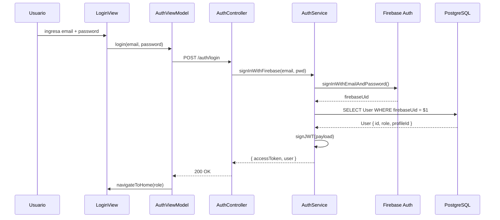

# Documento 3 — Diseño del Sistema
**Proyecto:** SPLG – App de Pedidos y Logística de Gas Envasado  
**Metodología:** Unified Process (UP)  
**Versión:** 1.0  
**Fecha:** 2026-04-17  
**Autor:** Nahuel Wagner  

---

## Leyenda de Prioridad

| Símbolo | Significado |
|---------|-------------|
| 🔴 | Crítico — bloquea operación sin este elemento |
| 🟡 | Importante — agrega valor significativo al MVP |
| ⚪ | Secundario — deseable pero no bloquea |
| 🤖 | Módulo Inteligente — proceso automático sin intervención humana |

---

## 1. Introducción

### 1.1 Propósito

Este documento describe el diseño técnico detallado del sistema SPLG, partiendo del análisis UP realizado en el Documento 2. Incluye los CU Reales con interacción UI, los diagramas de interacción a nivel de diseño, el diagrama de clases de diseño y la especificación detallada de los **3 módulos inteligentes** priorizados para la cátedra.

### 1.2 Alcance

El diseño cubre la **Fase 1** del sistema:
- Backend NestJS (API REST + WebSocket)
- App Cliente Flutter
- App Chofer Flutter
- Panel Administrativo React

### 1.3 Componentes del Sistema

| Componente | Tecnología | Estado |
|------------|------------|--------|
| Backend API | NestJS + TypeORM + PostgreSQL | ✅ Implementado (MVP) |
| Cache / Geo | Redis (GEOADD, GEORADIUS) | ✅ Implementado |
| WebSocket | Socket.IO + Redis Adapter | ✅ Backend implementado |
| App Cliente | Flutter (Stacked MVVM) | ✅ Implementado (MVP) |
| App Chofer | Flutter (Stacked MVVM) | 🔧 Parcial (GPS ✅, WS pendiente) |
| Panel Admin | React + MUI | 🔧 Parcial (navegación ✅, páginas en desarrollo) |
| Notificaciones | Firebase Cloud Messaging | ✅ Implementado |

---

## 2. Arquitectura del Sistema

### 2.1 Vista de Capas

```
┌─────────────────────────────────────────────────────────────┐
│                    CLIENTES (Frontends)                      │
│  App Cliente (Flutter)  │  App Chofer (Flutter)  │ Panel (React) │
└────────────┬────────────┴──────────┬─────────────┴──────┬────┘
             │ REST / HTTP           │ WebSocket           │ REST
             ▼                       ▼                     ▼
┌─────────────────────────────────────────────────────────────┐
│                     API GATEWAY (NestJS)                     │
│  Auth Guard (JWT)  │  Guards de Roles  │  Interceptors       │
├─────────────────────────────────────────────────────────────┤
│                   MÓDULOS DE NEGOCIO                         │
│  Orders  │  Dispatch  │  Delivery  │  Products  │  Claims    │
├─────────────────────────────────────────────────────────────┤
│                   MÓDULOS DE INFRAESTRUCTURA                 │
│  Redis Service  │  FCM Notifications  │  WebSocket Gateways  │
├─────────────────────────────────────────────────────────────┤
│                   PERSISTENCIA                               │
│  PostgreSQL (TypeORM)  │  Redis (Geo + Cache)               │
└─────────────────────────────────────────────────────────────┘
```

### 2.2 Módulos NestJS

| Módulo | Responsabilidad Principal |
|--------|--------------------------|
| `AuthModule` | JWT, Firebase Auth, guardias de roles |
| `OrderModule` | CRUD pedidos, máquina de estados, despacho |
| `DispatchModule` | Cron de reintentos, asignación por proximidad |
| `DeliveryModule` | Gestión de choferes, disponibilidad |
| `GasCylinderModule` | Catálogo, stock, promociones |
| `TimeSlotModule` | Franjas horarias y capacidades |
| `GatewaysModule` | WebSocket `/drivers` y `/customers` |
| `RedisModule` | GEOADD, GEORADIUS, operaciones geo |
| `NotificationsModule` | FCM push notifications |
| `ClaimsModule` | Reclamos y resolución |
| `ReportsModule` | Estadísticas y dashboard |

---

## 3. Casos de Uso Reales (CU Real)

> Esta sección presenta los **Casos de Uso Reales** según la plantilla UP de la cátedra. Cada CU priorizado se acompaña de:
>
> 1. **Interfaz Gráfica** — referencia al wireframe de la pantalla real en `design/wireframes.html`
> 2. **Especificación del CU Real** — tabla formal con todos los campos requeridos (Código, Objetivos asociados, Requisitos asociados, Descripción, Precondición, Secuencia, Postcondición, Excepciones, Rendimiento, Frecuencia, Estabilidad)
> 3. **Diagrama de Interacción** — flujo UI → ViewModel → Servicio → Backend
> 4. **Clases de Diseño Participantes**
>
> Los **5 CUs priorizados para Elaboración** según la cátedra son: **CU-001, CU-005, CU-013, CU-017, CU-020**. Adicionalmente se documentan CU-014 (cron de reintentos) y CU-015 (aceptar pedido) por su criticidad arquitectónica.

---

### 3.1 CU-001 🔴 — Iniciar Sesión

**Actor:** Cliente (ACT-01), Chofer (ACT-02), Administrador (ACT-03)
**Pantalla:** LoginView (App Cliente / App Chofer / Panel Admin)

#### Interfaz Gráfica

> Ver wireframe **D-19 — Login y Registro** en [`design/wireframes.html`](design/wireframes.html). Aplica a las tres apps con variantes mínimas (campos comunes: email, password).

#### Especificación del CU Real

| Campo | Detalle |
|-------|---------|
| **Código** | CU-001 |
| **Caso de Uso** | Iniciar Sesión |
| **Actor Principal** | ACT-01 (Cliente), ACT-02 (Chofer), ACT-03 (Administrador) |
| **Objetivos asociados** | OBJ-01, OBJ-05 |
| **Requisitos asociados** | IRQ-01, IRQ-03 |
| **Descripción** | El usuario ingresa email y contraseña en la pantalla de login. El sistema valida las credenciales contra Firebase Authentication y genera un JWT firmado con HS256 que contiene `userId` y `role`. La app persiste el token y navega a la HomeView según el rol. |
| **Precondición** | El usuario tiene una cuenta registrada en el sistema (CU-002 o CU-003). |

**Secuencia normal**

| Paso | Acción |
|------|--------|
| 1 | El usuario ingresa email y contraseña en `LoginView` y presiona "Iniciar sesión". |
| 2 | El cliente HTTP envía `POST /auth/login` con `{ email, password }`. |
| 3 | Backend `AuthController.login()` invoca `AuthService.signInWithFirebase()`. |
| 4 | Firebase Auth valida las credenciales y retorna `firebaseUid`. |
| 5 | Backend busca el `User` por `firebaseUid` para obtener `id`, `role`, `profileId`. |
| 6 | Genera JWT con `{ sub: userId, role, profileId }` firmado HS256, expiración 7 días. |
| 7 | Retorna `{ accessToken, user }` al cliente. |
| 8 | La app persiste el token en SecureStorage (Flutter) o cookie `httpOnly` (Panel Admin). |
| 9 | Navega a la HomeView correspondiente al rol. |

**Postcondición:** El usuario está autenticado. Los próximos requests incluyen `Authorization: Bearer <jwt>`. La sesión persiste hasta logout o expiración del token.

**Excepciones**

| Paso | Acción |
|------|--------|
| 4 | Si Firebase rechaza las credenciales → 401 "Credenciales inválidas". |
| 5 | Si el `User` no existe en BD pese a tener `firebaseUid` → 403 "Usuario no autorizado". |
| 5 | Si `role = CHOFER` y `Delivery.validated = false` → 403 "Cuenta pendiente de validación". |

| Campo | Detalle |
|-------|---------|
| **Rendimiento** | Tiempo de respuesta < 3 segundos. |
| **Frecuencia** | 1–5 logins por usuario por semana. |
| **Estabilidad** | Alta. |

#### Diagrama de Interacción



#### Clases de Diseño Participantes

| Clase | Capa | Responsabilidad |
|-------|------|-----------------|
| `LoginView` | Presentation (Flutter / React) | UI con email/password fields y botón |
| `AuthViewModel` | Presentation | Valida formulario, gestiona errores |
| `AuthController` | Backend Controller (NestJS) | Endpoint `POST /auth/login` |
| `AuthService` | Backend Service | Orquesta Firebase Auth + firma JWT |
| `JwtService` (NestJS) | Infrastructure | Firma y verifica tokens HS256 |

---

### 3.2 CU-005 🔴🤖 — Crear Pedido

**Actor:** Cliente (ACT-01)
**Pantalla:** CheckoutView (App Cliente)

#### Interfaz Gráfica

> Ver wireframe **D-17 — Checkout** en [`design/wireframes.html`](design/wireframes.html). Incluye carrito, dirección, franja horaria, fecha y método de pago.

#### Especificación del CU Real

| Campo | Detalle |
|-------|---------|
| **Código** | CU-005 |
| **Caso de Uso** | Crear Pedido |
| **Actor Principal** | ACT-01 (Cliente) |
| **Objetivos asociados** | OBJ-01, OBJ-04, OBJ-06 |
| **Requisitos asociados** | IRQ-02, IRQ-04 |
| **Descripción** | El cliente revisa el carrito en `CheckoutView`, selecciona dirección, franja horaria, fecha y método de pago. Al confirmar, el sistema valida y reserva atómicamente el stock dentro de una transacción PostgreSQL (Módulo M3), persiste la orden con estado PENDING y dispara el despacho automático (CU-013). |
| **Precondición** | El cliente está autenticado (CU-001). El carrito tiene ítems con cantidades > 0. |

**Secuencia normal**

| Paso | Acción |
|------|--------|
| 1 | El cliente accede a `CheckoutView` con ítems del carrito y completa: dirección, franja horaria, fecha de entrega y método de pago. |
| 2 | Presiona "Confirmar Pedido". `CheckoutViewModel.confirmOrder()` valida campos y aplica recargo del 10% si `paymentMethod = TRANSFER`. |
| 3 | Llama `historyService.createOrder()` → `POST /orders` con DTO completo. |
| 4 | Backend `OrderService.createOrder()` inicia QueryRunner + `startTransaction()`. |
| 5 | Aplica lock pesimista (`SELECT FOR UPDATE`) sobre cada `GasCylinder` involucrado. |
| 6 | Verifica stock suficiente y calcula precios con promociones por volumen (decimal.js). |
| 7 | Decrementa stock atómicamente. Persiste `Order` + `OrderItem[]`. |
| 8 | Hace `commitTransaction()`. Emite `triggerDispatch(orderId)` (CU-013) y `sendOrderConfirmation()` por FCM. |
| 9 | Retorna `{ orderId, status: PENDING, total }` al cliente. |
| 10 | La app navega a `OrderTrackingView`. |

**Postcondición:** Existe un `Order` con estado PENDING. El stock fue decrementado atómicamente. El despacho automático fue disparado.

**Excepciones**

| Paso | Acción |
|------|--------|
| 6 | Stock insuficiente → `BadRequestException` y rollback completo. El stock no se modifica. |
| 6 | Producto inactivo o inexistente → `NotFoundException` y rollback. |
| 7 | Falla al persistir → rollback automático. |

| Campo | Detalle |
|-------|---------|
| **Rendimiento** | Creación de pedido completa < 5 segundos. |
| **Frecuencia** | Estimado 50–200 pedidos/día. |
| **Estabilidad** | Alta. |

#### Flujo de Pantallas

```
[MarketView]
  └─▶ El cliente agrega garrafas al carrito
      └─▶ [CheckoutView]
            ├─ Sección 1: Resumen de ítems con descuentos aplicados
            ├─ Sección 2: Selección de dirección (MapView o AddressListSheet)
            ├─ Sección 3: Franja horaria (TimeRangeSelector - mañana 9-13 / tarde 17-21)
            ├─ Sección 4: Método de pago (PaymentMethodSelector)
            │             CASH | MERCADOPAGO | TRANSFER (+10% recargo automático)
            ├─ Sección 5: Fecha solicitada (DatePicker)
            └─ [Botón "Confirmar Pedido"] ─▶ [OrderTrackingView]
```

#### Interacción UI → ViewModel → Servicio → Backend

```
CheckoutView
  │  confirmOrder()
  ▼
CheckoutViewModel
  │  canConfirmOrder: address ≠ null && timeRange != null && items.length > 0
  │  finalTotal = itemsTotal + transferSurcharge (10% si TRANSFER)
  │  historyService.createOrder(updatedOrder)
  ▼
HistoryService (HTTP)
  │  POST /orders  { items, address, paymentMethod, deliveryWindowStart,
  │                  deliveryWindowEnd, requestedDeliveryDate, total }
  ▼
Backend: OrderController → OrderService.createOrder()
  │  [1] Verificar stock en QueryRunner
  │  [2] Calcular precio con promociones (decimal.js)
  │  [3] Aplicar recargo 10% si TRANSFER
  │  [4] Descontar stock (atómico)
  │  [5] Persist Order + OrderItems
  │  [6] triggerDispatch()  🤖 → DispatchService
  │  [7] FCM: sendOrderConfirmation()
  └─▶ return { orderId, status: PENDING, total }
```

#### Clases de Diseño Participantes

| Clase | Capa | Responsabilidad |
|-------|------|-----------------|
| `CheckoutViewModel` | Presentation (Flutter) | Orquesta UI, valida, llama servicio |
| `CartService` | Service (Flutter) | Mantiene estado del carrito reactivo |
| `HistoryService` | Service (Flutter) | HTTP al backend, persiste historial local |
| `OrderController` | Controller (NestJS) | Entrada HTTP, validación DTO |
| `OrderService` | Service (NestJS) | Lógica de negocio, transacción |
| `RedisService` | Infrastructure | GEOADD para índice de choferes |
| `NotificationsService` | Infrastructure | FCM push al cliente |

---

### 3.3 CU-013 🔴🤖 — Asignar Pedido Automáticamente por Proximidad

**Actor:** Sistema (ACT-04)
**Disparador:** `OrderService.createOrder()` → `triggerDispatch()`

#### Interfaz Gráfica

> CU sin pantalla propia (proceso automático del Sistema). La salida visible es la notificación del pedido entrante en App Chofer — ver wireframe **D-21 — Pedido Entrante** en [`design/wireframes.html`](design/wireframes.html).

#### Especificación del CU Real

| Campo | Detalle |
|-------|---------|
| **Código** | CU-013 |
| **Caso de Uso** | Asignar Pedido Automáticamente por Proximidad |
| **Actor Principal** | ACT-04 (Sistema) |
| **Objetivos asociados** | OBJ-02, OBJ-03 |
| **Requisitos asociados** | IRQ-04, IRQ-05 |
| **Descripción** | Al confirmar un pedido, el sistema busca automáticamente al chofer disponible más cercano usando Redis GEORADIUS sobre el índice geoespacial `drivers:available`. Sin intervención humana, notifica por WebSocket al chofer más próximo dentro de un radio de 5 km. |
| **Precondición** | Existe una orden con estado PENDING. El índice Redis `drivers:available` puede contener cero o más choferes activos. |

**Secuencia normal**

| Paso | Acción |
|------|--------|
| 1 | `OrderService.createOrder()` invoca `triggerDispatch(orderId)` post-commit. |
| 2 | `DispatchService.dispatchOrder()` obtiene `lat`, `lng` de la dirección de la orden. |
| 3 | Ejecuta `RedisService.geoRadius('drivers:available', lng, lat, 5)` — devuelve `driverIds` ordenados ASC por distancia. |
| 4 | Por cada `driverId` en orden de cercanía: verifica en BD que `Delivery.isActive = true` y `validated = true`. |
| 5 | Llama `DriversGateway.notifyNewOrder(driverId, payload)` → `socket.to(driverId).emit('order:new', { orderId, address, items, total, distance })`. |
| 6 | Detiene la búsqueda en el primer chofer elegible notificado. |
| 7 | Si no hay choferes elegibles: la orden queda en PENDING para que el cron M2 (CU-014) la reintente. |

**Postcondición:** El chofer más cercano disponible recibió la notificación en tiempo real. La orden permanece en PENDING hasta que el chofer la acepte (CU-015) o la rechace (CU-016).

**Excepciones**

| Paso | Acción |
|------|--------|
| 3 | Si Redis no está disponible → log de error y reintento por el cron M2. |
| 4 | Si todos los `driverId` retornados están desactivados o no validados → cae al paso 7. |
| 5 | Si la conexión WebSocket del chofer está caída → Socket.IO reintentará al reconectar; mientras, el cron M2 puede notificar a otro. |

| Campo | Detalle |
|-------|---------|
| **Rendimiento** | GEORADIUS < 500ms. Notificación WebSocket < 100ms desde el commit. |
| **Frecuencia** | Una vez por cada pedido creado (50–200 veces/día). |
| **Estabilidad** | Alta. |

#### Flujo del Algoritmo

```
triggerDispatch(orderId)
  │
  ▼
DispatchService.dispatchOrder(order)
  │  [1] Obtener coordenadas del pedido (lat/lng de la dirección)
  │  [2] redisService.GEORADIUS("drivers:available", lat, lng, 5km)
  │      └─▶ Devuelve lista de driverIds dentro del radio, ordenados por distancia
  │  [3] Por cada driverid (en orden de cercanía):
  │      ├─▶ Verificar driver.isActive && driver.validated en DB
  │      └─▶ driversGateway.notifyNewOrder(driverId, orderPayload)
  │              └─▶ socket.to(driverId).emit('order:new', payload)
  │  [4] Si no hay choferes disponibles:
  │      └─▶ El pedido queda en PENDING → cron lo reintentará en ~1 min
  │
  └─▶ Flujo continúa en CU-015 (Aceptar Pedido)
```

#### Estructura Redis para Geo-indexación

```
Key:   "drivers:available"
Type:  Sorted Set (GEO)
Value: { member: "driverId", score: geohash }

Operaciones:
  GEOADD  drivers:available  <lng> <lat> <driverId>   // Al activar disponibilidad
  GEORADIUS drivers:available <lng> <lat> 5 km ASC WITHDIST  // Al despachar
  ZREM    drivers:available  <driverId>               // Al desactivar / desconectar
```

#### Pantalla (App Chofer) — Notificación de Nuevo Pedido

```
[HomeView] (chofer disponible y conectado por WS)
  │  Socket recibe 'order:new' { orderId, address, items, total, distance }
  ▼
[OrderInfoBottomSheet]
  ├─ Dirección de entrega
  ├─ Ítems y total
  ├─ Distancia al cliente
  ├─ [Botón "Aceptar"] → CU-015
  └─ [Botón "Rechazar"] → CU-016
```

---

### 3.4 CU-014 🔴🤖 — Reintentar Asignación con Radio Expandido (Cron)

**Actor:** Sistema (ACT-04)  
**Disparador:** Cron Job (`@Cron('* * * * *')` — cada 1 minuto)

#### Flujo del Cron

```
DispatchService.handlePendingOrders() [cada 1 minuto]
  │
  │  [1] Buscar órdenes con status = PENDING y createdAt < now - 2 minutos
  │  [2] Por cada orden pendiente:
  │      ├─▶ Si intentos < 3: radio 5km
  │      ├─▶ Si intentos = 3: radio 10km
  │      └─▶ Si intentos ≥ 5: radio 15km → Admin notificado
  │  [3] GEORADIUS con radio calculado
  │  [4] Si hay choferes: notificar → igual que CU-013
  │  [5] Incrementar contador de intentos en la orden
  │  [6] Si intentos > MAX_RETRIES: marcar como SIN_COBERTURA, notificar Admin
  └─▶ Log del intento
```

#### Diagrama de Decisión

```
Orden PENDING + age > 2min
        │
        ├─ intentos < 3 ──▶ GEORADIUS 5km  ──▶ ¿Hay choferes?
        │                                        ├─ SI → notificar
        │                                        └─ NO → incrementar intentos
        ├─ intentos = 3 ──▶ GEORADIUS 10km ──▶ ¿Hay choferes?
        │                                        ├─ SI → notificar
        │                                        └─ NO → incrementar intentos
        ├─ intentos ≥ 5 ──▶ GEORADIUS 15km ──▶ ¿Hay choferes?
        │                                        ├─ SI → notificar
        │                                        └─ NO → continuar
        └─ intentos > MAX ──▶ Estado: SIN_COBERTURA → Notificar Admin (FCM/WS)
```

---

### 3.5 CU-015 🔴 — Aceptar Pedido

**Actor:** Chofer (ACT-02)  
**Pantalla:** OrderInfoBottomSheet (App Chofer)

```
[OrderInfoBottomSheet]
  │  Chofer presiona "Aceptar"
  ▼
OrderService (Flutter)
  │  PATCH /orders/:id/status  { status: "ACCEPTED" }
  ▼
Backend: OrderService.updateStatus(orderId, ACCEPTED, driverId)
  │  [1] Verificar orden en PENDING
  │  [2] Asignar driverId a la orden
  │  [3] Cancelar notificaciones a otros choferes (emit 'order:taken')
  │  [4] FCM al cliente: "Tu pedido fue aceptado por [chofer]"
  │  [5] customersGateway: emit 'order:accepted' → OrderTrackingView actualiza
  └─▶ return { status: ACCEPTED, driver: {...} }
```

---

### 3.6 CU-017 🔴🤖 — Actualizar Ubicación GPS del Chofer

**Actor:** Chofer (ACT-02)
**Disparador:** LocationService (Flutter) — stream continuo cada 10 metros

#### Interfaz Gráfica

> Ver wireframe **D-20 — Home del Chofer** y **D-22 — En Ruta** en [`design/wireframes.html`](design/wireframes.html). El chofer ve su posición en el mapa; el cliente ve la posición del chofer en su `OrderTrackingView` (wireframe **D-18**).

#### Especificación del CU Real

| Campo | Detalle |
|-------|---------|
| **Código** | CU-017 |
| **Caso de Uso** | Actualizar Ubicación GPS del Chofer |
| **Actor Principal** | ACT-02 (Chofer) |
| **Objetivos asociados** | OBJ-02, OBJ-03 |
| **Requisitos asociados** | IRQ-05 |
| **Descripción** | Mientras el chofer está disponible, su app emite eventos `driver:update-location` por WebSocket cada vez que el GPS detecta un movimiento de al menos 10 metros. El backend actualiza el índice geoespacial Redis y, si el chofer tiene un pedido en curso (ON_THE_WAY), reenvía la ubicación al cliente correspondiente para tracking en tiempo real. |
| **Precondición** | El chofer está autenticado, validado, con `isActive = true` y conectado al WebSocket `/drivers`. La app tiene permisos de ubicación concedidos. |

**Secuencia normal**

| Paso | Acción |
|------|--------|
| 1 | `LocationService.positionStream` emite una nueva `Position { lat, lng }` (cada 10 metros). |
| 2 | `HomeViewModel.onData(position)` recibe la posición y actualiza el marcador local en `GoogleMap`. |
| 3 | El cliente WebSocket emite `socket.emit('driver:update-location', { lat, lng })` al backend. |
| 4 | `DriversGateway.handleUpdateLocation()` recibe el evento. |
| 5 | Ejecuta `RedisService.geoAdd('drivers:available', lng, lat, driverId)` actualizando el índice. |
| 6 | Si el chofer tiene un pedido `ON_THE_WAY`: emite `customersGateway.emit('driver:location', { lat, lng })` al cliente correspondiente. |
| 7 | Retorna `ack: { ok: true }` al chofer. |

**Postcondición:** El índice Redis tiene la posición actualizada. Si hay pedido en curso, el cliente recibió la nueva posición del chofer en su mapa.

**Excepciones**

| Paso | Acción |
|------|--------|
| 1 | Si los permisos de ubicación se revocan → `LocationService` detiene el stream y muestra error en HomeView. |
| 3 | Si el WebSocket está desconectado → Socket.IO buffera el evento y reintenta al reconectar. |
| 5 | Si Redis no está disponible → log de error; el evento se descarta para esa actualización. |

| Campo | Detalle |
|-------|---------|
| **Rendimiento** | GEOADD < 100ms. Reenvío al cliente < 500ms desde el commit. |
| **Frecuencia** | Alta — una emisión cada 10 metros mientras el chofer está activo (estimado 1 evento cada 5–15s en movimiento). |
| **Estabilidad** | Alta. |

#### Diagrama de Flujo Detallado

```
[LocationService] (App Chofer)
  │  positionStream emite nueva Position
  ▼
HomeViewModel.onData(position)
  │  _updateUserLocation(position) → actualiza marcador en GoogleMap
  │  [pendiente] orderService.sendLocation(lat, lng)
  ▼
DriversGateway (WebSocket /drivers)
  │  socket.emit('driver:update-location', { lat, lng })
  ▼
DriversGateway.handleUpdateLocation()
  │  redisService.GEOADD("drivers:available", lng, lat, driverId)
  │  Si el driver tiene orden ON_THE_WAY:
  │      customersGateway.emit('driver:location', { lat, lng }) → cliente ve en mapa
  └─▶ ack: { ok: true }
```

**Nota de implementación:** El `connect()` en `HomeViewModel` es actualmente un `// TODO`. La integración WebSocket del App Chofer con el backend es parte del desarrollo pendiente.

---

### 3.7 CU-020 🔴 — Confirmar Entrega

**Actor:** Chofer (ACT-02)
**Pantalla:** DirectionsView / OrderInfoBottomSheet (App Chofer)

#### Interfaz Gráfica

> Ver wireframe **D-22 — En Ruta** en [`design/wireframes.html`](design/wireframes.html). Botón "Confirmar Entrega" disponible cuando la orden está en estado ON_THE_WAY.

#### Especificación del CU Real

| Campo | Detalle |
|-------|---------|
| **Código** | CU-020 |
| **Caso de Uso** | Confirmar Entrega |
| **Actor Principal** | ACT-02 (Chofer) |
| **Objetivos asociados** | OBJ-03, OBJ-04 |
| **Requisitos asociados** | IRQ-02, IRQ-08 |
| **Descripción** | El chofer entrega físicamente el producto y marca el pedido como entregado en su app. El sistema cierra el ciclo del pedido (estado DELIVERED), registra `deliveredAt`, marca el pago como PAID si era CASH, y notifica al cliente por WebSocket + FCM. |
| **Precondición** | El pedido tiene estado ON_THE_WAY. El chofer autenticado es el asignado al pedido. |

**Secuencia normal**

| Paso | Acción |
|------|--------|
| 1 | El chofer presiona "Confirmar entrega" en `DirectionsView`. |
| 2 | La app envía `PATCH /orders/:id/status` con `{ status: "DELIVERED" }`. |
| 3 | Backend `OrderController.updateStatus()` invoca `OrderService.updateStatus(orderId, DELIVERED, driverId)`. |
| 4 | El service verifica que la orden esté en estado ON_THE_WAY y que el chofer sea el asignado. |
| 5 | Actualiza `Order.status = DELIVERED` y registra `deliveredAt = now()`. |
| 6 | Si `paymentMethod = CASH`: actualiza `paymentStatus = PAID` automáticamente. |
| 7 | Emite `customersGateway.emit('order:delivered', { orderId })` al cliente por WebSocket. |
| 8 | Envía notificación FCM push al cliente: "¡Pedido entregado! Gracias por tu compra." |
| 9 | El chofer queda disponible para una nueva asignación (sigue en `drivers:available`). |
| 10 | Retorna `{ status: DELIVERED, deliveredAt }` a la app del chofer. |

**Postcondición:** El pedido tiene estado DELIVERED y `deliveredAt` registrado. Si el pago era CASH, queda PAID. El cliente fue notificado. El ciclo de entrega está cerrado.

**Excepciones**

| Paso | Acción |
|------|--------|
| 4 | Si el pedido no está en estado ON_THE_WAY → 400 "Transición de estado no permitida." |
| 4 | Si el chofer no es el asignado → 403 "No autorizado." |
| 4 | Si el pedido ya está DELIVERED o CANCELLED → 400 "El pedido ya está finalizado." |

| Campo | Detalle |
|-------|---------|
| **Rendimiento** | La confirmación debe procesarse en menos de 3 segundos. |
| **Frecuencia** | Una vez por cada pedido completado (50–200 veces/día). |
| **Estabilidad** | Alta. |

#### Diagrama de Flujo Detallado

```
[App Chofer] Chofer presiona "Confirmar Entrega"
  │  PATCH /orders/:id/status  { status: "DELIVERED" }
  ▼
OrderService.updateStatus(orderId, DELIVERED)
  │  [1] Registrar deliveredAt timestamp
  │  [2] FCM al cliente: "¡Tu pedido fue entregado!"
  │  [3] customersGateway: emit 'order:delivered'
  │  [4] redisService: GEOADD → chofer sigue disponible para próxima orden
  └─▶ return { status: DELIVERED }
```

---

## 4. Diagramas de Interacción (Nivel de Diseño)

### 4.1 Secuencia — CU-005: Crear Pedido con Despacho Automático

> Representación textual de secuencia (sustituir con diagrama draw.io o PlantUML)

```
Cliente         CheckoutVM    HistoryService   OrderController  OrderService    DispatchService    DriversGW       FCM
   |                |               |                 |               |                |               |             |
   |─confirmOrder()─▶               |                 |               |                |               |             |
   |                │─createOrder()─▶                 |               |                |               |             |
   |                |               │─POST /orders────▶               |                |               |             |
   |                |               |                 │─createOrder()─▶                |               |             |
   |                |               |                 |               │─QueryRunner.start()             |             |
   |                |               |                 |               │─checkStock()   |               |             |
   |                |               |                 |               │─calcPricing()  |               |             |
   |                |               |                 |               │─deductStock()  |               |             |
   |                |               |                 |               │─save(order)    |               |             |
   |                |               |                 |               │─commit()       |               |             |
   |                |               |                 |               │─triggerDispatch(orderId)────────▶             |
   |                |               |                 |               |                │─GEORADIUS()   |             |
   |                |               |                 |               |                │───────────────▶notifyOrder()|
   |                |               |                 |               │─sendConfirmation()───────────────────────────▶|
   |                |               |                 │─return order──▶               |               |             |
   |                |               │─return success──▶               |               |               |             |
   |─navigateTo(OrderTracking)──────▶               |                 |               |               |             |
```

### 4.2 Secuencia — CU-013: Despacho por Proximidad

```
DispatchService                   RedisService          DriversGateway
      |                                |                      |
      │─dispatchOrder(order)           |                      |
      │─getCoords(order.address)       |                      |
      │─GEORADIUS(lat,lng,5km)────────▶|                      |
      │◀─[driverId1, driverId2, ...]───|                      |
      │─forEach driverId:              |                      |
      │   validateDriver(id)           |                      |
      │   notifyNewOrder(id, payload)──────────────────────────▶
      │                                |           socket.to(id).emit('order:new')
```

### 4.3 Secuencia — CU-017: Actualización de Ubicación

```
LocationService(Flutter)   HomeViewModel(Flutter)   DriversGateway(NestJS)   RedisService
        |                         |                         |                      |
        │─positionStream.add(pos)─▶                         |                      |
        |                         │─onData(position)        |                      |
        |                         │─_updateUserLocation()   |                      |
        |                         │─socket.emit('driver:update-location', {lat,lng})▶
        |                         |                         │─GEOADD(drivers:available, lng, lat, driverId)─▶
        |                         |                         │─if ON_THE_WAY:       |
        |                         |                         │  customers.emit('driver:location', {lat,lng})
```

---

## 5. Diagrama de Clases de Diseño

> Los diagramas de clases completos deben generarse en draw.io. Se incluye la especificación textual.

### 5.1 Clases del Dominio de Pedidos

```
┌──────────────────────────────────────┐
│              Order                    │
├──────────────────────────────────────┤
│ id: string (UUID)                    │
│ status: OrderStatus                  │
│   PENDING | ACCEPTED | ON_THE_WAY   │
│   DELIVERED | CANCELLED             │
│ paymentMethod: PaymentMethod         │
│   CASH | MERCADOPAGO | TRANSFER     │
│ total: number (decimal.js)           │
│ createdAt: Date                      │
│ acceptedAt?: Date                    │
│ deliveredAt?: Date                   │
│ deliveryWindowStart?: string         │
│ deliveryWindowEnd?: string           │
│ requestedDeliveryDate?: Date         │
│ dispatchAttempts: number             │
├──────────────────────────────────────┤
│ customer: Customer (ManyToOne)       │
│ driver?: Delivery (ManyToOne)        │
│ items: OrderItem[] (OneToMany)       │
│ claim?: Claim (OneToOne)             │
└──────────────────────────────────────┘
         │ items
         ▼
┌──────────────────────────────────────┐
│              OrderItem               │
├──────────────────────────────────────┤
│ id: string                           │
│ quantity: number                     │
│ unitPrice: number                    │
│ subtotal: number                     │
│ appliedDiscountPct?: number          │
├──────────────────────────────────────┤
│ gasCylinder: GasCylinder (ManyToOne)│
└──────────────────────────────────────┘

┌──────────────────────────────────────┐
│            GasCylinder               │
├──────────────────────────────────────┤
│ id: string                           │
│ type: string                         │
│ price: number                        │
│ stock: number                        │
│ isActive: boolean                    │
│ promotions: Promotion[] (JSONB)      │
└──────────────────────────────────────┘

Promotion {
  quantity: number
  discountPercentage: number
}

┌──────────────────────────────────────┐
│              Delivery (Chofer)        │
├──────────────────────────────────────┤
│ id: string                           │
│ isActive: boolean                    │
│ validated: boolean                   │
│ calification?: number                │
│ balance: number                      │
│ latLng?: string                      │
├──────────────────────────────────────┤
│ user: User (OneToOne)                │
│ car?: Car (ManyToOne)                │
└──────────────────────────────────────┘

┌──────────────────────────────────────┐
│              Claim                   │
├──────────────────────────────────────┤
│ id: string                           │
│ description: string                  │
│ status: ClaimStatus                  │
│   PENDING | IN_PROCESS | RESOLVED   │
│   REJECTED                          │
│ photoUrl?: string                    │
│ resolutionNote?: string              │
├──────────────────────────────────────┤
│ order: Order (OneToOne)              │
│ customer: Customer (ManyToOne)       │
└──────────────────────────────────────┘
```

### 5.2 Clases de Servicio (Backend — Capa de Aplicación)

```
OrderService
  + createOrder(dto, userId): Promise<Order>        🤖 llama triggerDispatch
  + updateStatus(id, status, driverId?): Promise<Order>
  + cancelOrder(id, role, userId): Promise<Order>   🤖 restituye stock
  + getOrderStats(): Promise<StatsDto>
  + getSalesChartData(days): Promise<ChartData[]>

DispatchService
  + dispatchOrder(order): Promise<void>             🤖 GEORADIUS 5km
  + handlePendingOrders(): Promise<void>            🤖 Cron cada 1 min

RedisService
  + geoAdd(key, lng, lat, member): Promise<void>
  + geoRadius(key, lng, lat, radius): Promise<string[]>
  + zRem(key, member): Promise<void>

DriversGateway  [WebSocket /drivers]
  + handleConnection(socket): void                  JWT auth
  + handleJoin(socket, data): void                  registra socket
  + handleUpdateLocation(socket, data): void        🤖 GEOADD
  + notifyNewOrder(driverId, order): void
  + notifyOrderCancelled(driverId, orderId): void

CustomersGateway  [WebSocket /customers]
  + handleConnection(socket): void
  + notifyOrderAccepted(customerId, driver): void
  + notifyDriverLocation(customerId, location): void
  + notifyOrderDelivered(customerId): void
```

### 5.3 Clases de Presentación — App Cliente (Flutter, MVVM)

```
CheckoutViewModel (ReactiveViewModel)
  - _cartService: CartService
  - _historyService: HistoryService
  - _customerService: CustomerService
  + initialize(): void
  + setPaymentMethod(method): void
  + openMap(): Future<void>
  + showAddressList(): Future<void>
  + selectDate(context): Future<void>
  + confirmOrder(): Future<void>
  + getSubtotal(item): double         🤖 calcula descuento
  + getAppliedDiscount(item): Discount?
  + itemsTotal: double
  + transferSurcharge: double         🤖 +10% si TRANSFER
  + finalTotal: double
  + canConfirmOrder: bool

CartService (ListenableServiceMixin)
  - _order: ReactiveValue<Order?>
  + order: Order?
  + setOrder(order): void
  + clearOrder(): void
  + editingOrderId: String?
```

### 5.4 Clases de Presentación — App Chofer (Flutter, MVVM)

```
HomeViewModel (StreamViewModel<Position>)
  - _orderService: OrderService
  - _locationService: LocationService
  + stream: Stream<Position>           🤖 GPS continuo
  + onData(position): void
  + initialize(): Future<void>
  + onMapCreated(controller): Future<void>
  + _updateUserLocation(position): void
  + centerOnUserLocation(): Future<void>
  + connect(): Future<void>            ⚠️ TODO: integrar WebSocket

LocationService (ListenableServiceMixin)
  - _positionSubscription: StreamSubscription
  + positionStream: Stream<Position>
  + startTracking(): Future<void>      🤖 actualiza cada 10 metros
  + stopTracking(): Future<void>
  + getCurrentLocation(): Future<Position?>
  + calculateDistance(...): double
```

---

## 6. Módulos Inteligentes — Especificación Detallada

### Selección de 3 Módulos para la Cátedra

De los **10 módulos automáticos** identificados en el Análisis (Doc 2), se priorizan los 3 que forman el pipeline completo de despacho automático, por su complejidad arquitectónica y por integrar múltiples tecnologías (PostgreSQL + Redis + WebSocket + Cron).

| # | Módulo | CU | Justificación |
|---|--------|-----|---------------|
| M1 | Despacho Automático por Proximidad | CU-013 | Algoritmo geoespacial Redis GEORADIUS. Mayor complejidad técnica. |
| M2 | Cron de Reintentos con Radio Expandido | CU-014 | Automatización temporal, lógica adaptativa, observabilidad. |
| M3 | Reserva Atómica de Stock con Rollback | CU-005 | Integridad transaccional PostgreSQL, prevención de race conditions. |

---

### 6.1 Módulo M1 🤖 — Despacho Automático por Proximidad

**Archivo:** `src/order/dispatch.service.ts`

#### Descripción
Cuando se crea un pedido, el sistema automáticamente busca el chofer disponible más cercano a la dirección de entrega usando la estructura GEO de Redis. Sin intervención humana, notifica al chofer más próximo en tiempo real por WebSocket.

#### Entradas
- `order.address.lat`, `order.address.lng` — coordenadas del punto de entrega
- Redis key `drivers:available` — índice geoespacial de choferes activos

#### Proceso

```typescript
async dispatchOrder(order: Order): Promise<void> {
  const { lat, lng } = order.address;

  // GEORADIUS: devuelve drivers dentro del radio, ordenados por distancia ASC
  const nearbyDriverIds = await this.redisService.geoRadius(
    'drivers:available', lng, lat, 5  // 5 km
  );

  for (const driverId of nearbyDriverIds) {
    const driver = await this.deliveryRepo.findOne({
      where: { id: driverId, isActive: true, validated: true }
    });
    if (!driver) continue;

    // Notificar al chofer más cercano disponible
    await this.driversGateway.notifyNewOrder(driverId, {
      orderId: order.id,
      address: order.address,
      items: order.items,
      total: order.total,
    });
    return; // Primer chofer elegible notificado
  }
  // Sin choferes → queda PENDING para el Cron (M2)
}
```

#### Salidas
- WebSocket `order:new` → App Chofer del driver seleccionado
- Si no hay choferes: orden permanece `PENDING`

#### Precondiciones
- La orden existe con estado `PENDING`
- Redis contiene al menos un driver en el índice GEO

#### Postcondiciones
- El chofer más cercano recibe notificación instantánea
- Si no hay choferes: la orden queda en cola para M2

---

### 6.2 Módulo M2 🤖 — Cron de Reintentos con Radio Expandido

**Archivo:** `src/order/dispatch.service.ts` — método `handlePendingOrders()`

#### Descripción
Cada minuto, el sistema verifica órdenes que llevan más de 2 minutos sin ser aceptadas. Reintenta el despacho con radio progresivamente mayor para cubrir zonas sin choferes cercanos.

#### Entradas
- Cron trigger: `@Cron('* * * * *')` (cada 1 minuto)
- Query: `WHERE status = 'PENDING' AND createdAt < NOW() - INTERVAL '2 minutes'`

#### Proceso

```
Cron dispara cada 60 segundos
  └▶ SELECT órdenes PENDING con age > 2 min
       └▶ Para cada orden:
            │
            ├─ dispatchAttempts < 3  →  GEORADIUS 5 km
            ├─ dispatchAttempts = 3  →  GEORADIUS 10 km
            ├─ dispatchAttempts ≥ 5  →  GEORADIUS 15 km
            └─ dispatchAttempts > 8  →  Estado: SIN_COBERTURA
                                         Notificar Administrador
            │
            ├─ ¿Hay drivers? → notifyNewOrder() (igual M1)
            └─ ¿No hay? → order.dispatchAttempts++ → save()
```

#### Tabla de Radios

| Intentos | Radio | Tiempo transcurrido aprox. |
|----------|-------|---------------------------|
| 0–2 | 5 km | 0–4 min (despacho inicial) |
| 3–4 | 10 km | 5–6 min |
| 5–7 | 15 km | 7–9 min |
| > 8 | SIN_COBERTURA | > 10 min |

#### Decisiones de Diseño
- **Idempotencia**: Si el mismo chofer ya fue notificado, el sistema evita duplicar la notificación.
- **Observabilidad**: Cada intento registra `dispatchAttempts` en la BD para auditoría.
- **Límite de radio**: 15 km es el máximo configurado para mantener tiempos de entrega razonables.

---

### 6.3 Módulo M3 🤖 — Reserva Atómica de Stock con Rollback

**Archivo:** `src/order/order.service.ts` — método `createOrder()`

#### Descripción
Al crear un pedido, el sistema reserva el stock de cada garrafa pedida dentro de una transacción PostgreSQL. Si cualquier paso falla (precio inválido, stock insuficiente, error de red), la transacción hace rollback automático, garantizando que nunca quede stock fantasma comprometido.

#### Entradas
- `orderItems[]`: arreglo de `{ cylinderId, quantity }`
- Datos de pago, dirección, franja horaria

#### Proceso

```typescript
async createOrder(dto: CreateOrderDto, userId: string): Promise<Order> {
  const queryRunner = this.dataSource.createQueryRunner();
  await queryRunner.connect();
  await queryRunner.startTransaction();

  try {
    // [1] Verificar stock para cada ítem (dentro de la transacción)
    for (const item of dto.items) {
      const cylinder = await queryRunner.manager.findOne(GasCylinder, {
        where: { id: item.cylinderId },
        lock: { mode: 'pessimistic_write' }  // SELECT FOR UPDATE
      });
      if (!cylinder || cylinder.stock < item.quantity) {
        throw new BadRequestException(`Stock insuficiente: ${cylinder?.type}`);
      }
    }

    // [2] Calcular precios con descuentos (decimal.js para precisión)
    const orderItems = dto.items.map(item => ({
      ...item,
      unitPrice: cylinder.price,
      subtotal: this.calcSubtotal(cylinder, item.quantity),
      appliedDiscountPct: this.getDiscount(cylinder, item.quantity),
    }));

    // [3] Aplicar recargo si TRANSFER
    const surcharge = dto.paymentMethod === 'TRANSFER'
      ? new Decimal(itemsTotal).mul(0.10).toNumber()
      : 0;

    // [4] Descontar stock atómicamente
    for (const item of dto.items) {
      await queryRunner.manager.decrement(
        GasCylinder, { id: item.cylinderId }, 'stock', item.quantity
      );
    }

    // [5] Persistir la orden
    const order = queryRunner.manager.create(Order, { ...dto, total, items: orderItems });
    await queryRunner.manager.save(order);

    // [6] Commit: si todo OK, confirma todos los cambios juntos
    await queryRunner.commitTransaction();

    // [7] Post-commit: despacho y notificación (fuera de la transacción)
    await this.dispatchService.dispatchOrder(order);
    await this.notificationsService.sendOrderConfirmation(order);

    return order;

  } catch (error) {
    // ROLLBACK: deshace TODO si algo falla
    await queryRunner.rollbackTransaction();
    throw error;
  } finally {
    await queryRunner.release();
  }
}
```

#### Garantías del Módulo

| Garantía | Mecanismo |
|----------|-----------|
| No doble-gasto de stock | `SELECT FOR UPDATE` (lock pesimista) |
| Precisión monetaria | `decimal.js` (evita errores float) |
| Atomicidad completa | `QueryRunner` con commit/rollback explícito |
| Sin stock fantasma | Rollback automático ante cualquier falla |
| Restitución en cancelación | `cancelOrder()` con mismo patrón transaccional |

---

## 7. Pantallas UI — Wireframes y Diagramas

> Esta sección documenta los **assets visuales** del sistema (wireframes y diagramas UML) que acompañan cada CU Real de §3. Los wireframes están renderizados en HTML/CSS y los diagramas en Mermaid, todos listos para screenshot o exportar PNG sin requerir Lucidchart.

### 7.1 Wireframes — Inventario y Ubicación

Los **9 wireframes** del sistema están renderizados en [`design/wireframes.html`](design/wireframes.html) usando phone frames CSS para móvil y desktop browser frames para Panel Admin. Listos para screenshot directo (Cmd+Shift+4 en macOS).

| ID | Pantalla | App | CU asociado | Frame |
|----|----------|-----|------------|-------|
| **D-16** | Catálogo de Productos | App Cliente | CU-041 | Móvil 294px |
| **D-17** | Checkout (carrito + franja + pago) | App Cliente | CU-005 | Móvil 294px |
| **D-18** | Seguimiento en Tiempo Real | App Cliente | CU-017, CU-021 | Móvil 294px |
| **D-19** | Login y Registro | App Cliente / App Chofer / Admin | CU-001, CU-002 | Móvil 294px |
| **D-20** | Home del Chofer (toggle disponibilidad) | App Chofer | CU-022 | Móvil 294px |
| **D-21** | Pedido Entrante (bottom sheet) | App Chofer | CU-015 | Móvil 294px |
| **D-22** | En Ruta (mapa + confirmar entrega) | App Chofer | CU-018, CU-020 | Móvil 294px |
| **D-23** | Dashboard del Admin | Panel Admin | CU-026 | Desktop 880px |
| **D-24** | Listado de Pedidos (Admin) | Panel Admin | CU-011 | Desktop 880px |

**Cómo capturarlos como PNG individuales:**

1. Abrir `docs/design/wireframes.html` en el navegador (doble clic).
2. Hacer scroll hasta la pantalla deseada.
3. Cmd+Shift+4 (macOS) o Win+Shift+S (Windows) para captura selectiva.
4. Guardar en `docs/design/` con el nombre indicado en el wireframe (ej: `ui-cliente-checkout.png`).

### 7.2 Referencia de UX: Rappi / PedidosYa

Los wireframes siguen el patrón visual de las apps líderes del segmento (Rappi, PedidosYa). Coincidencias clave del sistema con su flujo de tracking:

```
[App Cliente — SPLG / Rappi / PedidosYa]

1. CATÁLOGO con cards de producto y botón flotante "Ver pedido"
2. CHECKOUT con resumen, dirección, método de pago — SPLG agrega franja horaria + fecha
3. SEGUIMIENTO con mapa en vivo + stepper de estados (mismo patrón visual)

[App Chofer — SPLG / Rappi Repartidor]

4. HOME con toggle de disponibilidad + mapa
5. PEDIDO ENTRANTE como bottom sheet con timer
6. EN RUTA con botones "Avisar llegada" + "Confirmar entrega"
```

### 7.3 Diagramas UML — Ubicación

Todos los **diagramas UML** del sistema (modelo conceptual, DSS, secuencia de diseño, clases) están en [`docs/diagramas.md`](diagramas.md) en formato Mermaid. Listos para pegar en [mermaid.live](https://mermaid.live) y exportar PNG.

| Tipo | ID | Para qué CU | Doc destino |
|------|----|-----------|-------------|
| Casos de Uso del Sistema | D-01 | Vista global | Doc 0 §6 / Doc 1 §3 |
| Diagrama de Subsistemas | D-02 | Vista de subsistemas | Doc 1 §4 |
| CU por Subsistema | D-SS01 a D-SS09 | Uno por subsistema (SS-01 a SS-09) | Doc 1 §6 |
| Modelo Conceptual | D-03 | Modelo del dominio | Doc 2 §1.5 |
| DSS por CU | D-04 a D-10 | CU-005, 013, 014, 015, 017, 020 + Stock | Doc 2 §2.1 |
| Arquitectura | D-11 | Vista de capas | Doc 3 §2.1 |
| Clases de Diseño | D-12 | Diagrama UML de clases | Doc 3 §5 |
| Secuencia de Diseño | D-13 a D-15 | CU-005, 013, 017 | Doc 3 §4 |

### 7.4 Diagrama ER de la Base de Datos

El **diagrama Entidad-Relación** de la BD está en [`docs/analisis-bd.md`](analisis-bd.md) sección "Diagrama Entidad-Relación". Mermaid `erDiagram` con las 13 entities del backend NestJS, listo para Lucidchart vía Insert → Mermaid.

### 7.5 Cómo insertar imágenes en este documento

Una vez exportadas las PNG, reemplazar los placeholders en cada sección de §3 (CU Real) con:

```markdown

*Figura X — CheckoutView (App Cliente) — CU-005*
```

Los `[INSERTAR IMAGEN: ...]` que aparezcan en otros docs (Doc 0 §6, Doc 1 §3, Doc 2 §1.5) se reemplazan con el mismo patrón apuntando al archivo PNG correspondiente.

---

## 8. Decisiones de Diseño Relevantes

| Decisión | Alternativa Descartada | Razón |
|----------|----------------------|-------|
| Redis GEORADIUS para radar de choferes | Query PostGIS en PostgreSQL | Redis es in-memory → latencia <1ms; despacho debe ser instantáneo |
| WebSocket (Socket.IO) para tracking | Polling HTTP cada 5s | Polling genera 12× más tráfico; WS push es en tiempo real |
| QueryRunner con lock pesimista para stock | Optimistic locking (version) | Con 100+ pedidos simultáneos, optimistic genera demasiados reintentos |
| decimal.js para precios | number nativo JS | `0.1 + 0.2 = 0.30000000000000004` — inaceptable en montos monetarios |
| FCM para notificaciones push | WebSocket directo | FCM funciona con app cerrada; WS requiere conexión activa |
| Stacked MVVM en Flutter | Provider / Bloc | Separación más estricta de UI/lógica; DI integrado (get_it) |

---

## 9. Trazabilidad Diseño → Análisis → Requisitos

| Elemento de Diseño | Elemento Análisis (Doc 2) | CU (Doc 1) | Requisito (Doc 1) |
|--------------------|--------------------------|------------|-------------------|
| `DispatchService.dispatchOrder()` | DSS-CU013 `asignarPorProximidad` | CU-013 | IRQ-04 |
| `DispatchService.handlePendingOrders()` | DSS-CU014 `reintentarConRadioExpandido` | CU-014 | IRQ-04 |
| `OrderService.createOrder()` QueryRunner | DSS-CU005 `crearPedido` | CU-005 | IRQ-02, IRQ-03 |
| `DriversGateway.handleUpdateLocation()` | DSS-CU017 `actualizarUbicacion` | CU-017 | IRQ-05 |
| `OrderService.updateStatus(DELIVERED)` | Contrato `confirmarEntrega` | CU-020 | IRQ-06 |
| `CheckoutViewModel.transferSurcharge` | — | CU-005 | IRQ-02 |
| `LocationService.startTracking()` | DSS-CU017 | CU-017 | IRQ-05 |

---

## 10. Pendientes de Implementación (Gaps Identificados)

| Gap | Descripción | CU Afectado | Prioridad |
|-----|-------------|-------------|-----------|
| WebSocket App Chofer | `connect()` en HomeViewModel es `// TODO` | CU-017, CU-015 | 🔴 Crítico |
| Validación capacidad franja horaria | Campo `capacity` existe pero no se valida al crear pedido | CU-044 | 🟡 Importante |
| Endpoint foto de entrega | `photoUrl` en Claim es string; no hay upload de imagen | CU-023 | 🟡 Importante |
| Endpoint de calificación de chofer | Campo `calification` en Delivery sin endpoint | CU-020 | 🟡 Importante |
| Páginas del Panel Admin | Navegación definida; páginas de orders/stats/maps en desarrollo | CU-011, CU-026 | 🟡 Importante |

