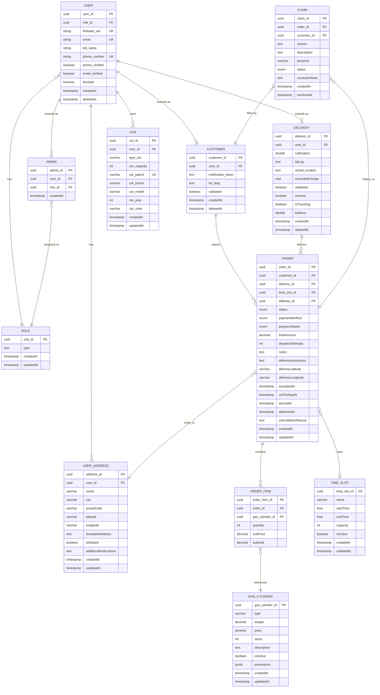

# Análisis de Base de Datos — SPLG

**Proyecto:** SPLG – Sistema de Pedidos y Logística de Garrafas de Gas
**Versión:** 1.0
**Fecha:** 2026-05-08
**Autor:** Nahuel Wagner

---

## Resumen Ejecutivo

Se encontraron **13 entities principales** en el backend NestJS (User, Customer, Delivery, Admin, Role, Order, OrderItem, GasCylinder, Claim, TimeSlot, UserAddress, Car, Notification — esta última vacía). El modelo está **~85% completo y funcional**. Se detectaron **11 gaps** de los cuales **3 son CRÍTICOS** (bloquean implementación de CUs) y **3 son de severidad ALTA** (necesarios para auditoría). Las entities `Notification`, `Paymentgatway`, `Webhook`, `Email` y `Seed` están vacías y son deferibles a Fase 2.

---

## Inventario Detallado de Entities

| Entity | Tabla | Columnas Principales | Cardinalidad | Notas |
|--------|-------|---------------------|--------------|-------|
| **User** | `user` | `user_id` (PK, UUID), `firebase_uid` (UK), `email` (UK), `full_name`, `phone_number`, `phone_verified`, `email_verified`, `blocked`, `createdAt`, `deletedAt`, `role_id` (FK) | 1:1→Customer, 1:1→Delivery, 1:N→Car, 1:N→Admin, 1:N→UserAddress | Tabla central. Soft-delete activo. |
| **Customer** | `customer` | `customer_id` (PK), `user_id` (FK, UK), `notification_token`, `lat_lang`, `validated` (text ⚠️), `createdAt`, `deletedAt` | 1:1←User | ⚠️ `validated` debería ser boolean. |
| **Delivery** | `delivery` | `delivery_id` (PK), `user_id` (FK, UK), `calification`, `latLng`, `actual_location`, `cancelledCharge`, `validated` (boolean), `isActive` (boolean), `isTraveling` (text ⚠️), `balance`, `createdAt`, `deletedAt` | 1:1←User | ⚠️ `isTraveling` debería ser boolean. Falta `rejectedDriverIds[]`. |
| **Admin** | `admin` | `admin_id` (PK), `user_id` (FK), `role_id` (FK) | N:1→User, N:1→Role | Tabla de asociación. |
| **Role** | `role` | `role_id` (PK), `type`, `createdAt`, `updatedAt` | 1:N→User, 1:N→Admin | Catálogo de roles. |
| **Order** | `order` | `order_id` (PK), `customer_id` (FK), `delivery_id` (FK, nullable), `time_slot_id` (FK), `address_id` (FK), `status` (enum), `paymentMethod` (enum), `paymentStatus` (enum), `totalAmount`, `notes`, `deliveryInstructions`, `deliveryLatitude`, `deliveryLongitude`, `acceptedAt`, `onTheWayAt`, `deliveredAt`, `cancellationReason`, `createdAt`, `updatedAt` | 1:N→OrderItem, N:1→Customer, N:1→Delivery, N:1→TimeSlot, N:1→UserAddress | ❌ Falta `dispatchAttempts` (CU-014). ❌ Falta `arrivedAt` (CU-019/020). |
| **OrderItem** | `order_item` | `order_item_id` (PK), `order_id` (FK), `gas_cylinder_id` (FK), `quantity`, `unitPrice`, `subtotal` | N:1→Order, N:1→GasCylinder | Snapshot de precio. |
| **GasCylinder** | `gas_cylinder` | `gas_cylinder_id` (PK), `type`, `weight`, `price`, `stock`, `description`, `isActive`, `promotions` (jsonb), `createdAt`, `updatedAt` | 1:N←OrderItem | OK. Promociones por volumen en JSONB. |
| **TimeSlot** | `time_slot` | `time_slot_id` (PK), `name`, `startTime`, `endTime`, `capacity`, `isActive`, `createdAt`, `updatedAt` | 1:N←Order | OK. Bien modelado. |
| **UserAddress** | `user_address` | `address_id` (PK), `user_id` (FK), `street`, `city`, `postalCode`, `latitude`, `longitude`, `formattedAddress`, `isDefault`, `additionalInstructions`, `createdAt`, `updatedAt` | N:1→User | Bien. Multi-dirección por usuario. |
| **Claim** | `claims` | `claim_id` (PK), `order_id` (FK), `customer_id` (FK), `reason`, `description`, `photoUrl`, `status` (enum), `resolutionNote`, `createdAt` | N:1→Order, N:1→Customer | ❌ Falta `resolvedAt` y `updatedAt`. |
| **Car** | `car` | `car_id` (PK), `user_id` (FK), `type_car`, `car_capacity`, `car_patent` (UK), `car_brand`, `car_model`, `car_year`, `car_color`, `createdAt`, `updatedAt` | N:1→User | OK. |
| **Notification, Paymentgatway, Webhook, Email, Seed** | varios | *(vacías)* | — | No implementadas. Deferibles a Fase 2. |

---

## Diagrama Entidad-Relación (Mermaid)

> Pegar este código en [mermaid.live](https://mermaid.live) para renderizar y exportar PNG. También se puede importar directamente en Lucidchart vía la integración de Mermaid (Insert → Mermaid).



---

## Gaps Detectados — Campos Faltantes en BD

| Campo | Entity | CU que lo Menciona | Severidad | Acción Recomendada |
|-------|--------|--------------------|:---------:|--------------------|
| `dispatchAttempts` | Order | CU-014 (Reintentar Asignación con Radio Expandido) | 🔴 **CRÍTICA** | Sin este campo, no se puede implementar el cron de reintentos. Agregar `int dispatchAttempts default 0`. |
| `validated` (tipo) | Customer | CU-002 (Registro Cliente) | 🔴 **CRÍTICA** | Cambiar de `text` a `boolean` por consistencia con `Delivery.validated`. |
| `isTraveling` (tipo) | Delivery | CU-017, CU-018 | 🔴 **CRÍTICA** | Cambiar de `text` a `boolean`. O eliminar si se infiere de `Order.status = ON_THE_WAY`. |
| `arrivedAt` | Order | CU-019 (Avisar Llegada al Cliente) | 🟠 ALTA | Agregar `timestamp arrivedAt nullable`. Necesario para registrar transición ON_THE_WAY → ARRIVED. |
| `resolvedAt` | Claim | CU-025 (Resolver Reclamo) | 🟠 ALTA | Agregar `timestamp resolvedAt nullable`. Auditoría de cierre de reclamos. |
| `rejectedDriverIds[]` | Delivery o tabla intermedia | CU-016 (Rechazar/Ignorar Pedido) | 🟠 ALTA | Implementar como `uuid[]` en Order o tabla junction `order_driver_rejection`. Previene re-notificación al mismo chofer. |
| `appliedDiscountPct` | OrderItem | CU-005 (Crear Pedido) | 🟡 MEDIA | Ya está implícito en (`unitPrice * quantity` vs `subtotal`), pero explícito ayuda a reportes. |
| `updatedAt` | Claim | CU-024, CU-025 | 🟡 MEDIA | Agregar para auditoría de cambios. |

---

## Gaps Detectados — Campos Huérfanos en BD

Campos presentes en la BD pero no documentados en ningún CU. Requieren clarificación o eliminación.

| Campo | Entity | Comentario | Acción |
|-------|--------|-----------|--------|
| `selfie` | User | ¿Foto de perfil? ¿Validación KYC? No mencionado en CUs. | Documentar propósito o remover. |
| `lat_lang` | Customer | Última ubicación conocida del cliente. Redundante si está en Redis. | Revisar — ¿necesario persistir? |
| `actual_location` | Delivery | Última ubicación. Confuso junto a `latLng`. | Consolidar en un solo campo. |
| `cancelledCharge` | Delivery | Cargo por cancelación de chofer. Sin documentación de negocio. | Clarificar regla de negocio. |
| `balance` | Delivery | Balance acumulado. ¿Moneda? ¿Pago al chofer? | Clarificar — ligado a Paymentgatway pendiente. |

---

## Migraciones Recomendadas (orden de aplicación)

### Migración 1 — Crítica (antes del próximo release)

```sql
-- Agregar campo de seguimiento de intentos de despacho
ALTER TABLE "order" ADD COLUMN "dispatchAttempts" int NOT NULL DEFAULT 0;

-- Convertir validated de text a boolean en Customer
ALTER TABLE customer ADD COLUMN "validated_new" boolean DEFAULT false;
UPDATE customer SET "validated_new" = (validated = 'true' OR validated = '1');
ALTER TABLE customer DROP COLUMN validated;
ALTER TABLE customer RENAME COLUMN "validated_new" TO validated;

-- Convertir isTraveling de text a boolean en Delivery
ALTER TABLE delivery ADD COLUMN "isTraveling_new" boolean DEFAULT false;
UPDATE delivery SET "isTraveling_new" = ("isTraveling" = 'true' OR "isTraveling" = '1');
ALTER TABLE delivery DROP COLUMN "isTraveling";
ALTER TABLE delivery RENAME COLUMN "isTraveling_new" TO "isTraveling";
```

### Migración 2 — Alta (Fase 2)

```sql
-- Timestamps de auditoría faltantes
ALTER TABLE "order" ADD COLUMN "arrivedAt" timestamp NULL;
ALTER TABLE claims ADD COLUMN "resolvedAt" timestamp NULL;
ALTER TABLE claims ADD COLUMN "updatedAt" timestamp DEFAULT NOW();

-- Tabla junction para registro de rechazos de pedidos
CREATE TABLE order_driver_rejection (
  id uuid PRIMARY KEY DEFAULT gen_random_uuid(),
  order_id uuid NOT NULL REFERENCES "order"(order_id),
  delivery_id uuid NOT NULL REFERENCES delivery(delivery_id),
  reason text NULL,
  rejectedAt timestamp DEFAULT NOW(),
  UNIQUE(order_id, delivery_id)
);
```

### Migración 3 — Limpieza (opcional)

```sql
-- Consolidar campos de ubicación duplicados en Delivery
-- (decidir entre latLng y actual_location, mantener uno)
ALTER TABLE delivery DROP COLUMN actual_location;

-- Documentar o remover campos huérfanos
-- (selfie, cancelledCharge, balance — definir antes de tocar)
```

---

## Conclusión

El modelo de datos está bien estructurado y cubre el 85% de los CUs documentados. Con las **3 correcciones críticas** de la Migración 1, el sistema queda implementable para todos los CUs Críticos definidos en `1-Requisitos.md §6.2`. Las correcciones de severidad Alta (Migración 2) son recomendadas antes del primer release a producción para garantizar auditoría completa.

**Prioridad inmediata:** ejecutar Migración 1 antes del próximo merge a `main`.

---

## Diagrama Completo para Lucidchart (Modelo Ideal)

> **Archivo listo para importar:** [`docs/bd-completo.sql`](bd-completo.sql)
>
> Este SQL DDL es el **modelo de datos completo y final** del sistema, incluyendo:
> - Las 13 entities actuales (con todos los campos faltantes ya integrados)
> - Las 5 tablas previamente vacías ahora completadas según su propósito (Notification, Payment_Gateway, Webhook, Email, Seed)
> - 1 tabla nueva de auditoría (`audit_log`)
> - 1 tabla intermedia nueva (`order_driver_rejection`)
> - **Total: 19 tablas + 1 vista, 28 FKs, 23 índices**

### Tablas adicionales completadas en el SQL

| # | Tabla | Estado anterior | Propósito completado |
|---|-------|:---------------:|----------------------|
| 13 | **notification** | Vacía | Historial de notificaciones (FCM, WebSocket, Email, SMS) con estado, retry y payload |
| 14 | **payment_gateway** | Vacía | Registro de pagos procesados por MercadoPago/Stripe con `preference_id`, `payment_id`, status y respuesta completa |
| 15 | **webhook** | Vacía | Log de webhooks entrantes (MP, Firebase) con payload, validación de firma y estado de procesamiento |
| 16 | **email** | Vacía | Cola y log de emails transaccionales con templates y estado de envío |
| 17 | **seed** | Vacía | Registro de seeds ejecutados (data inicial, demo, fixtures) — útil para tracking de versiones |
| 18 | **audit_log** | NO EXISTÍA | Auditoría completa de operaciones sensibles: quién, qué, cuándo, valores antes/después |
| 19 | **order_driver_rejection** | NO EXISTÍA | Tabla intermedia que registra rechazos chofer↔pedido para prevenir re-notificación |

### Cómo importar el SQL en Lucidchart (paso a paso)

**Opción 1 — Desde un documento nuevo (recomendado):**

1. Entrar a [lucid.app](https://lucid.app) → "+ New" → "Lucidchart Document".
2. En el menú superior: **Files → Import Data → Database**.
3. Elegir el dialect **"PostgreSQL"**.
4. Abrir [`docs/bd-completo.sql`](bd-completo.sql) en cualquier editor, copiar TODO el contenido (Cmd+A, Cmd+C).
5. Pegar en el textarea de Lucidchart.
6. Click **"Import"** — Lucidchart genera automáticamente el diagrama ER con todas las tablas y relaciones FK.
7. Aplicar **Auto-Layout** desde el panel derecho para distribuir las tablas.
8. Exportar como PNG: **File → Export → PNG** (resolución 2x para impresión nítida).

**Opción 2 — Desde un documento existente:**

1. Abrir un Lucidchart Document.
2. En el panel izquierdo de shapes, buscar **"Database"** o **"ERD"**.
3. Click en **"Import data"** dentro de la categoría Database.
4. Pegar el SQL como en la Opción 1.

**Opción 3 — Si Lucidchart no acepta directamente:**

1. Subir el archivo `bd-completo.sql` al servicio externo [dbdiagram.io](https://dbdiagram.io) (gratuito).
2. Convertir el formato y exportar como imagen o como PDF.
3. Importar la imagen a Lucidchart como referencia.

### Características del diagrama generado

Una vez importado, Lucidchart muestra:

- **Cajas con compartimentos**: cada tabla con su nombre, columnas (PK/FK marcadas) y tipos de datos.
- **Líneas de relación**: con cardinalidades (`1`, `N`, `0..1`) leyendo las FK del SQL.
- **Diferentes tipos de líneas**: línea sólida = NOT NULL, línea punteada = NULL.
- **Crow's foot notation**: notación profesional estándar para diagramas ER.

### Personalización recomendada en Lucidchart

Después del auto-layout, agrupar visualmente por colores:

| Capa de datos | Tablas | Color sugerido |
|---------------|--------|---------------|
| **Identidad** | user, customer, delivery, admin, role | `#D6E4FF` (azul claro) |
| **Negocio core** | order, order_item, gas_cylinder | `#FFE4B5` (naranja claro) |
| **Logística** | time_slot, user_address, car | `#D9F7BE` (verde claro) |
| **Reclamos** | claims | `#FFD6D6` (rosa claro) |
| **Pagos** | payment_gateway, webhook | `#E5D6FF` (violeta claro) |
| **Auxiliares** | notification, email, seed | `#F0F0F0` (gris claro) |
| **Auditoría** | audit_log, order_driver_rejection | `#FFF7CD` (amarillo claro) |

En Lucidchart: seleccionar la tabla → panel derecho "Fill" → elegir el color.

### Comparación: Modelo actual vs Modelo ideal

| Aspecto | BD actual | Modelo ideal (SQL) |
|---------|:---------:|:------------------:|
| Tablas operativas | 13 (5 vacías) | 19 (todas con campos definidos) |
| Auditoría de cambios | ❌ | ✅ `audit_log` |
| Prevención de re-notificación | ❌ | ✅ `order_driver_rejection` |
| Tracking de despacho | ❌ Falta `dispatchAttempts` | ✅ Incluido + radio + timestamp |
| Trazabilidad de estados de pedido | Parcial (3 timestamps) | ✅ Completa (5 timestamps) |
| Conciliación de pagos | ❌ Sin tabla | ✅ `payment_gateway` + `webhook` |
| Logs de notificaciones | ❌ Tabla vacía | ✅ Historial completo con retry |
| Cola de emails | ❌ Tabla vacía | ✅ Sistema completo con templates |

### Notas sobre los enums en Lucidchart

Los valores de tipo enum (status, role, etc.) están como `VARCHAR` con un `CHECK` en algunos casos y un comentario inline indicando los valores válidos. Esto es deliberado para máxima compatibilidad con el importador de Lucidchart, que tiene mejor soporte para tipos básicos que para `ENUM` de PostgreSQL.

Si preferís usar `CREATE TYPE ... AS ENUM (...)` real, podés convertir las columnas correspondientes después de importar el diagrama.
