# Diagramas SPLG — Códigos Listos para Renderizar
**Proyecto:** SPLG – Sistema de Pedidos y Logística de Garrafas de Gas  
**Versión:** 1.0  
**Fecha:** 2026-05-03  
**Autor:** Nahuel Wagner  

---

## Cómo usar este documento

| Tipo | Herramienta | Pasos |
|------|-------------|-------|
| **Mermaid** | [mermaid.live](https://mermaid.live) | 1. Ir a mermaid.live → 2. Pegar el código → 3. Ver el resultado → 4. Descargar PNG |
| **Mermaid en Lucidchart** | [lucid.app](https://lucid.app) | 1. Abrir Lucidchart → 2. Click en `+` → 3. Buscar "Mermaid" → 4. Pegar el código |
| **Wireframes** | [excalidraw.com](https://excalidraw.com) o Lucidchart | Seguir instrucciones de cada sección |

> **Recomendación rápida:** usar **mermaid.live** para los diagramas técnicos (D-01 a D-15) y **excalidraw.com** para los wireframes (D-16 a D-24). Excalidraw no requiere registro, es gratis y exporta PNG al instante.

---

## Índice de Diagramas

| ID | Diagrama | Doc | Sección plantilla cátedra |
|----|----------|-----|---------------------------|
| D-01 | Diagrama de Casos de Uso del Sistema | Doc 0 §6 / Doc 1 §3 | CU diagram con actores y límite del sistema |
| D-02 | Diagrama de Subsistemas | Doc 1 §4 | Organización funcional del sistema |
| D-03 | Modelo Conceptual | Doc 2 §1.5 | Clases del dominio, relaciones, multiplicidades |
| D-04 | DSS — CU-005 Crear Pedido | Doc 2 §2.1 | Secuencia sistema caja negra |
| D-05 | DSS — CU-013 Despacho Automático | Doc 2 §2.1 | Secuencia sistema caja negra |
| D-06 | DSS — CU-014 Cron Reintentos | Doc 2 §2.1 | Secuencia sistema caja negra |
| D-07 | DSS — CU-015 Aceptar Pedido | Doc 2 §2.1 | Secuencia sistema caja negra |
| D-08 | DSS — CU-017 Actualizar GPS | Doc 2 §2.1 | Secuencia sistema caja negra |
| D-09 | DSS — CU-020 Confirmar Entrega | Doc 2 §2.1 | Secuencia sistema caja negra |
| D-10 | DSS — Stock Transaccional | Doc 2 §2.1 | Secuencia sistema caja negra |
| D-11 | Arquitectura del Sistema | Doc 3 §2.1 | Vista de capas con tecnologías |
| D-12 | Diagrama de Clases de Diseño | Doc 3 §5 | Clases con atributos, métodos y relaciones |
| D-13 | Seq. Diseño — CU-005 Crear Pedido | Doc 3 §4.1 | Interacción entre clases reales |
| D-14 | Seq. Diseño — CU-013 Despacho | Doc 3 §4.2 | Interacción entre clases reales |
| D-15 | Seq. Diseño — CU-017 GPS | Doc 3 §4.3 | Interacción entre clases reales |
| D-16 | Wireframe — Catálogo de Productos | Doc 3 §7 | UI App Cliente CU-041 |
| D-17 | Wireframe — Checkout | Doc 3 §7 | UI App Cliente CU-005 |
| D-18 | Wireframe — Seguimiento en Tiempo Real | Doc 3 §7 | UI App Cliente CU-017/CU-021 |
| D-19 | Wireframe — Login y Registro | Doc 3 §7 | UI App Cliente/Chofer CU-001/002 |
| D-20 | Wireframe — Home del Chofer | Doc 3 §7 | UI App Chofer CU-022 |
| D-21 | Wireframe — Pedido Entrante | Doc 3 §7 | UI App Chofer CU-015 |
| D-22 | Wireframe — En Ruta | Doc 3 §7 | UI App Chofer CU-018/020 |
| D-23 | Wireframe — Dashboard Admin | Doc 3 §7 | UI Panel Admin CU-026 |
| D-24 | Wireframe — Listado de Pedidos Admin | Doc 3 §7 | UI Panel Admin CU-011 |
| D-SS01 | CU por Subsistema — SS-01 Autenticación | Doc 1 §6 | Actores y CUs del subsistema |
| D-SS02 | CU por Subsistema — SS-02 Gestión de Pedidos | Doc 1 §6 | Actores y CUs del subsistema |
| D-SS03 | CU por Subsistema — SS-03 Despacho y Asignación | Doc 1 §6 | Actores y CUs del subsistema |
| D-SS04 | CU por Subsistema — SS-04 Seguimiento en Tiempo Real | Doc 1 §6 | Actores y CUs del subsistema |
| D-SS05 | CU por Subsistema — SS-05 Reclamos | Doc 1 §6 | Actores y CUs del subsistema |
| D-SS06 | CU por Subsistema — SS-06 Reportes y Dashboard | Doc 1 §6 | Actores y CUs del subsistema |
| D-SS07 | CU por Subsistema — SS-07 Gestión de Choferes | Doc 1 §6 | Actores y CUs del subsistema |
| D-SS08 | CU por Subsistema — SS-08 Productos e Inventario | Doc 1 §6 | Actores y CUs del subsistema |
| D-SS09 | CU por Subsistema — SS-09 Franjas Horarias | Doc 1 §6 | Actores y CUs del subsistema |

---

## DOC 0 + DOC 1 — Casos de Uso y Subsistemas

---

### D-01 | Diagrama de Casos de Uso del Sistema

**Plantilla cátedra (Doc 0 §6 / Doc 1 §3):** Diagrama UML de Casos de Uso con límite del sistema, los 4 actores (Cliente, Chofer, Administrador, Sistema) y los CUs organizados por subsistema con asociaciones actor → CU.  
**Guardar como:** `docs/diagrama-cu-sistema.png`  
**Insertar en:** Doc 0 §6 y Doc 1 §3 reemplazando el placeholder `[ INSERTAR IMAGEN: diagrama-cu-sistema.png ]`

> Se incluyen los 19 CU Críticos + CUs Importantes principales. Para los 45 completos, ver guía de draw.io en Doc 0 §9.

```mermaid
flowchart LR
    ACT01["👤 Cliente (ACT-01)"]
    ACT02["👤 Chofer (ACT-02)"]
    ACT03["👤 Administrador (ACT-03)"]
    ACT04["⚙️ Sistema (ACT-04)"]

    subgraph SPLG["« system » SPLG – Sistema de Pedidos y Logística de Garrafas de Gas"]
        subgraph SS01["SS-01 Autenticación"]
            CU001(["CU-001 Iniciar Sesión"])
            CU002(["CU-002 Registrarse como Cliente"])
            CU003(["CU-003 Registrar Chofer"])
        end
        subgraph SS02["SS-02 Gestión de Pedidos"]
            CU005(["CU-005 Crear Pedido"])
            CU006(["CU-006 Ver Detalle de Pedido"])
            CU007(["CU-007 Historial de Pedidos"])
            CU008(["CU-008 Cancelar Pedido"])
            CU011(["CU-011 Listar Pedidos"])
        end
        subgraph SS03["SS-03 Despacho y Asignación"]
            CU013(["🤖 CU-013 Despacho Automático"])
            CU014(["🤖 CU-014 Cron Reintentos"])
            CU015(["CU-015 Aceptar Pedido"])
        end
        subgraph SS04["SS-04 Seguimiento RT"]
            CU017(["CU-017 Actualizar GPS"])
            CU018(["CU-018 Marcar En Camino"])
            CU020(["CU-020 Confirmar Entrega"])
            CU021(["CU-021 Notificaciones RT"])
            CU022(["CU-022 Toggle Disponibilidad"])
        end
        subgraph SS05["SS-05 Reclamos"]
            CU023(["CU-023 Registrar Reclamo"])
            CU025(["CU-025 Resolver Reclamo"])
        end
        subgraph SS06["SS-06 Reportes"]
            CU026(["CU-026 Dashboard General"])
            CU027(["CU-027 Ventas por Chofer"])
        end
        subgraph SS07["SS-07 Choferes"]
            CU031(["CU-031 Registrar Chofer"])
            CU032(["CU-032 Validar Chofer"])
        end
        subgraph SS08["SS-08 Productos"]
            CU036(["CU-036 Crear Producto"])
            CU038(["CU-038 Actualizar Stock"])
            CU041(["CU-041 Catálogo Productos"])
        end
        subgraph SS09["SS-09 Franjas Horarias"]
            CU042(["CU-042 Crear Franja"])
            CU044(["CU-044 Seleccionar Franja"])
        end
    end

    ACT01 --- CU001
    ACT01 --- CU002
    ACT01 --- CU005
    ACT01 --- CU006
    ACT01 --- CU007
    ACT01 --- CU008
    ACT01 --- CU021
    ACT01 --- CU023
    ACT01 --- CU041
    ACT01 --- CU044

    ACT02 --- CU001
    ACT02 --- CU015
    ACT02 --- CU017
    ACT02 --- CU018
    ACT02 --- CU020
    ACT02 --- CU022

    ACT03 --- CU001
    ACT03 --- CU011
    ACT03 --- CU025
    ACT03 --- CU026
    ACT03 --- CU027
    ACT03 --- CU031
    ACT03 --- CU032
    ACT03 --- CU036
    ACT03 --- CU038
    ACT03 --- CU042

    ACT04 --- CU013
    ACT04 --- CU014
```

---

### D-02 | Diagrama de Subsistemas

**Plantilla cátedra (Doc 1 §4):** Diagrama que muestra los 9 subsistemas del proyecto, los frontends que los consumen y la infraestructura de soporte, con flechas de dependencia.  
**Guardar como:** `docs/diagrama-subsistemas.png`  
**Insertar en:** Doc 1 §4 reemplazando el placeholder `[ INSERTAR IMAGEN: diagrama-subsistemas.png ]`

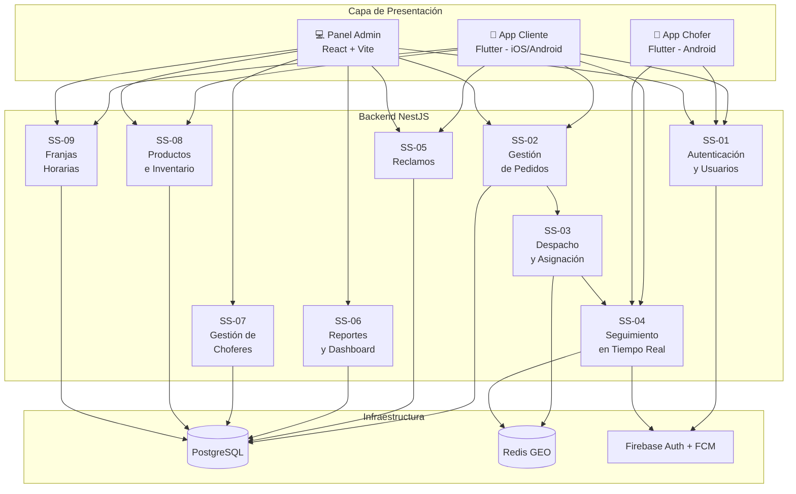

---

### D-SS01 | CU por Subsistema — SS-01 Autenticación y Usuarios

**Plantilla cátedra (Doc 1 §6):** Diagrama de casos de uso del subsistema SS-01 con actores y los 4 CUs de autenticación y gestión de perfil.  
**Guardar como:** `docs/diagrama-cu-ss01.png`

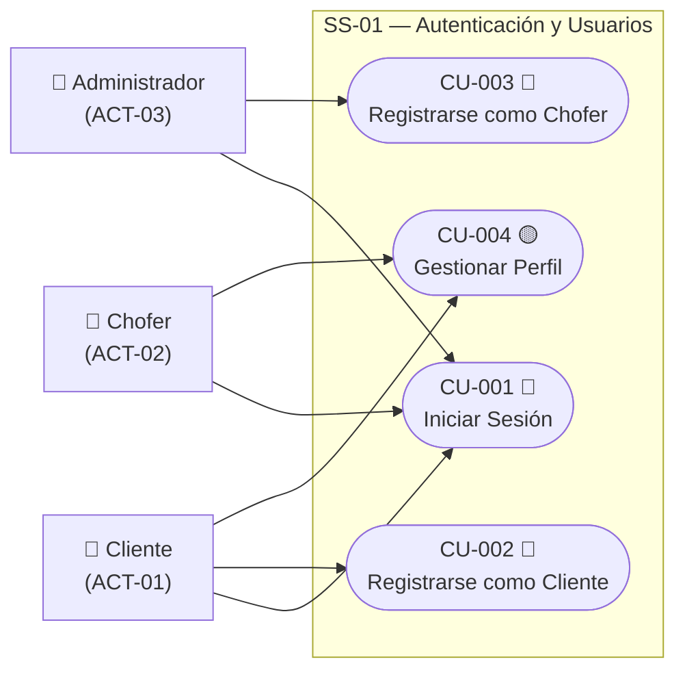

---

### D-SS02 | CU por Subsistema — SS-02 Gestión de Pedidos

**Plantilla cátedra (Doc 1 §6):** Diagrama de casos de uso del subsistema SS-02 con los 8 CUs de creación, consulta y cancelación de pedidos.  
**Guardar como:** `docs/diagrama-cu-ss02.png`

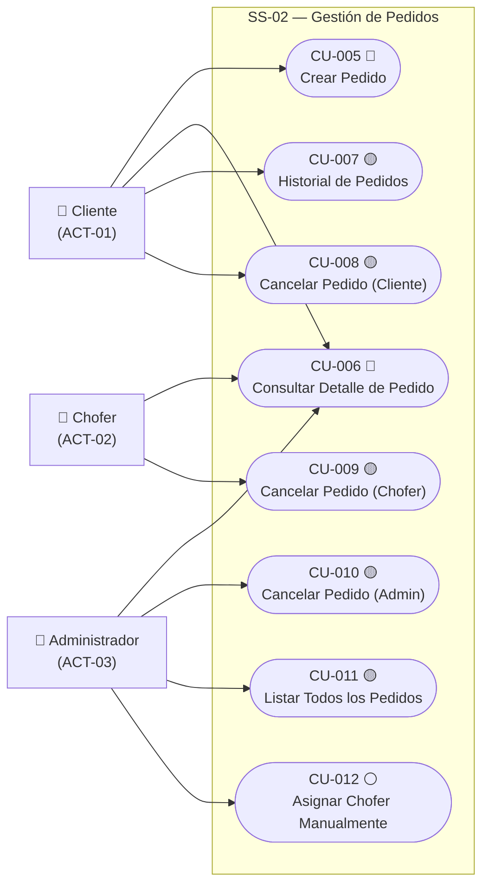

---

### D-SS03 | CU por Subsistema — SS-03 Despacho y Asignación

**Plantilla cátedra (Doc 1 §6):** Diagrama de casos de uso del subsistema SS-03 con los 4 CUs del ciclo de despacho automático y aceptación de pedidos.  
**Guardar como:** `docs/diagrama-cu-ss03.png`

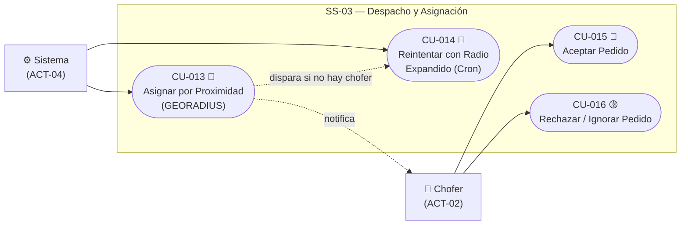

---

### D-SS04 | CU por Subsistema — SS-04 Seguimiento en Tiempo Real

**Plantilla cátedra (Doc 1 §6):** Diagrama de casos de uso del subsistema SS-04 con los 6 CUs de tracking GPS, estados de entrega y notificaciones.  
**Guardar como:** `docs/diagrama-cu-ss04.png`

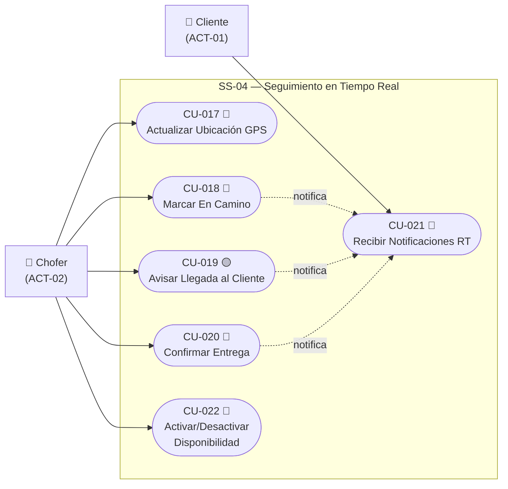

---

### D-SS05 | CU por Subsistema — SS-05 Reclamos

**Plantilla cátedra (Doc 1 §6):** Diagrama de casos de uso del subsistema SS-05 con los 3 CUs del ciclo de vida de un reclamo.  
**Guardar como:** `docs/diagrama-cu-ss05.png`

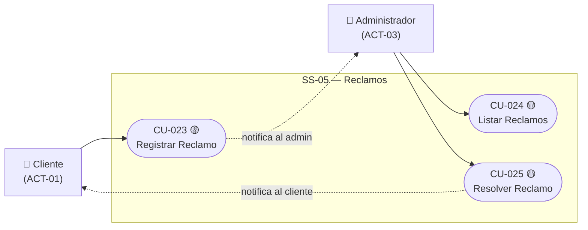

---

### D-SS06 | CU por Subsistema — SS-06 Reportes y Dashboard

**Plantilla cátedra (Doc 1 §6):** Diagrama de casos de uso del subsistema SS-06 con los 5 CUs de reportes y visualización de métricas del negocio.  
**Guardar como:** `docs/diagrama-cu-ss06.png`

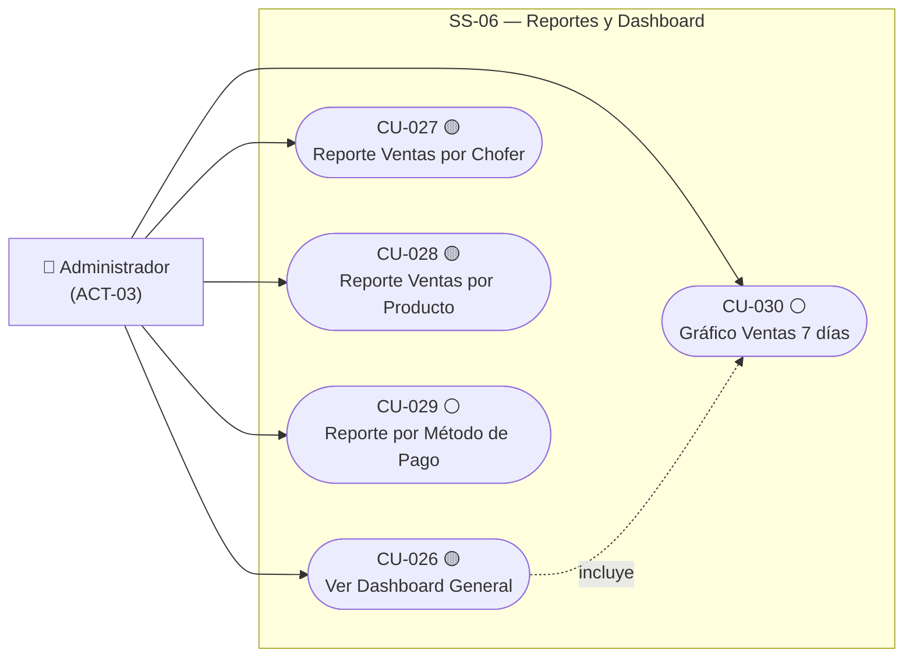

---

### D-SS07 | CU por Subsistema — SS-07 Gestión de Choferes y Vehículos

**Plantilla cátedra (Doc 1 §6):** Diagrama de casos de uso del subsistema SS-07 con los 5 CUs de administración de choferes y sus vehículos.  
**Guardar como:** `docs/diagrama-cu-ss07.png`

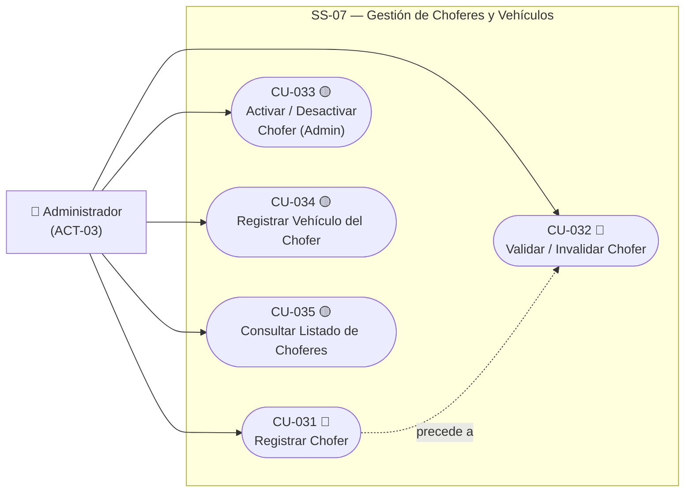

---

### D-SS08 | CU por Subsistema — SS-08 Gestión de Productos e Inventario

**Plantilla cátedra (Doc 1 §6):** Diagrama de casos de uso del subsistema SS-08 con los 6 CUs de administración del catálogo de garrafas.  
**Guardar como:** `docs/diagrama-cu-ss08.png`

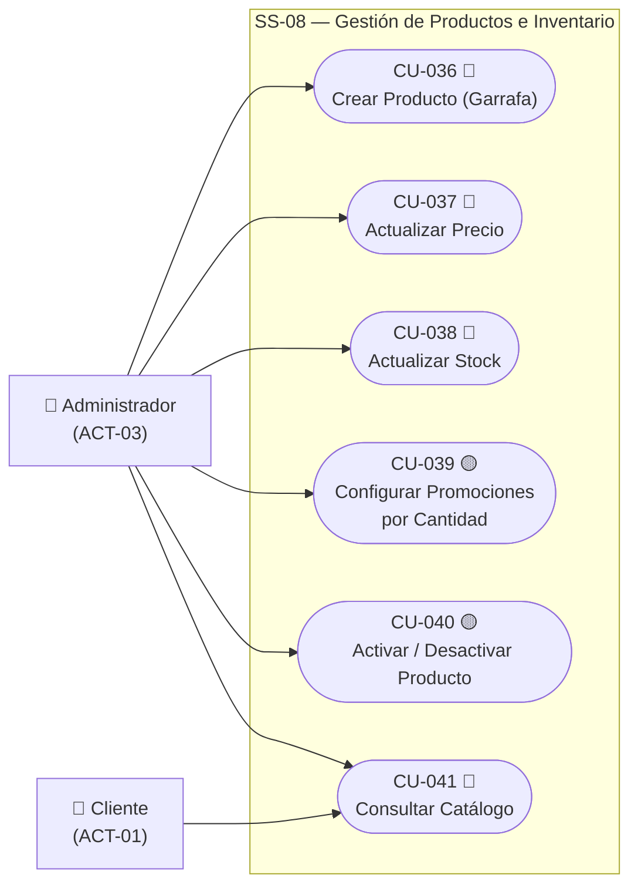

---

### D-SS09 | CU por Subsistema — SS-09 Franjas Horarias

**Plantilla cátedra (Doc 1 §6):** Diagrama de casos de uso del subsistema SS-09 con los 4 CUs de gestión y selección de franjas horarias de entrega.  
**Guardar como:** `docs/diagrama-cu-ss09.png`

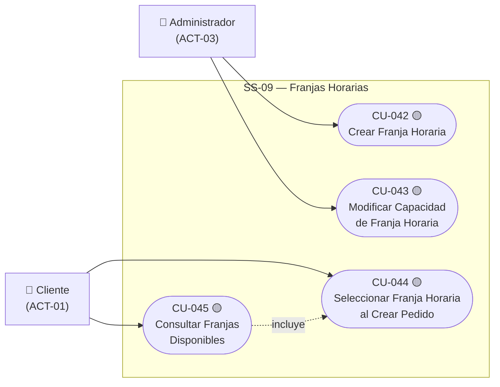

---

## DOC 2 — Modelo Conceptual y Diagramas de Secuencia del Sistema

---

### D-03 | Modelo Conceptual

**Plantilla cátedra (Doc 2 §1.5):** Diagrama de clases del dominio SIN métodos. Muestra los 13 conceptos idóneos con atributos clave, relaciones (herencia, composición, asociación) y multiplicidades.  
**Guardar como:** `docs/diagrama-conceptual.png`  
**Insertar en:** Doc 2 §1.5 reemplazando el placeholder `[ INSERTAR IMAGEN: diagrama-conceptual.png ]`

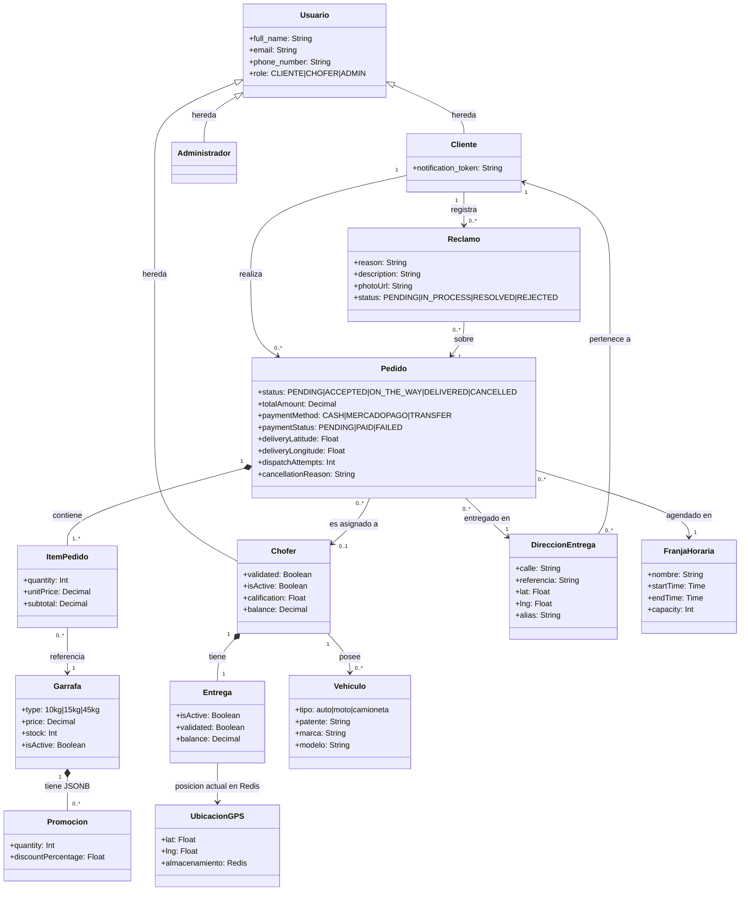

---

### D-04 | DSS — CU-005: Crear Pedido

**Plantilla cátedra (Doc 2 §2.1):** Diagrama de Secuencia de Sistema. Sistema como caja negra. Muestra los mensajes de entrada/salida y el fragmento `alt` para cuando hay o no hay choferes disponibles.  
**Guardar como:** `docs/dss-cu005-crear-pedido.png`  
**Insertar en:** Doc 2 §2.1 reemplazando `[ INSERTAR IMAGEN: dss-cu005-crear-pedido.png ]`

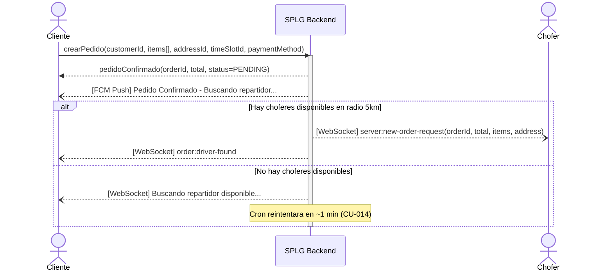

---

### D-05 | DSS — CU-013: Despacho Automático por Proximidad

**Plantilla cátedra (Doc 2 §2.1):** DSS disparado automáticamente por CU-005. Actor: Sistema (ACT-04). Muestra consulta a Redis y notificación WebSocket a choferes.  
**Guardar como:** `docs/dss-cu013-despacho.png`  
**Insertar en:** Doc 2 §2.1 reemplazando `[ INSERTAR IMAGEN: dss-cu013-despacho-automatico.png ]`

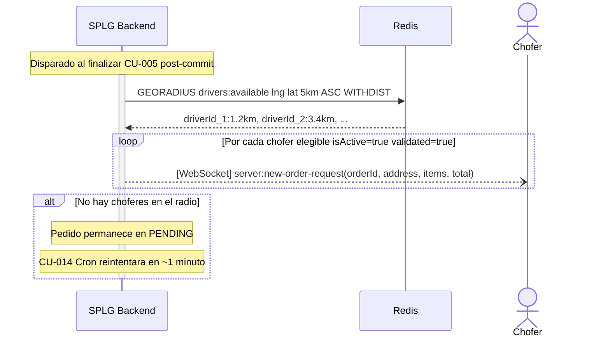

---

### D-06 | DSS — CU-014: Reintentar Asignación con Radio Expandido (Cron)

**Plantilla cátedra (Doc 2 §2.1):** DSS del proceso cron automático. Actor: Sistema (automático, cada 1 minuto). Muestra el ciclo de reintentos con radio progresivo 5km → 10km → 15km → SIN_COBERTURA.  
**Guardar como:** `docs/dss-cu014-cron.png`  
**Insertar en:** Doc 2 §2.1 reemplazando `[ INSERTAR IMAGEN: dss-cu014-cron-reintento.png ]`

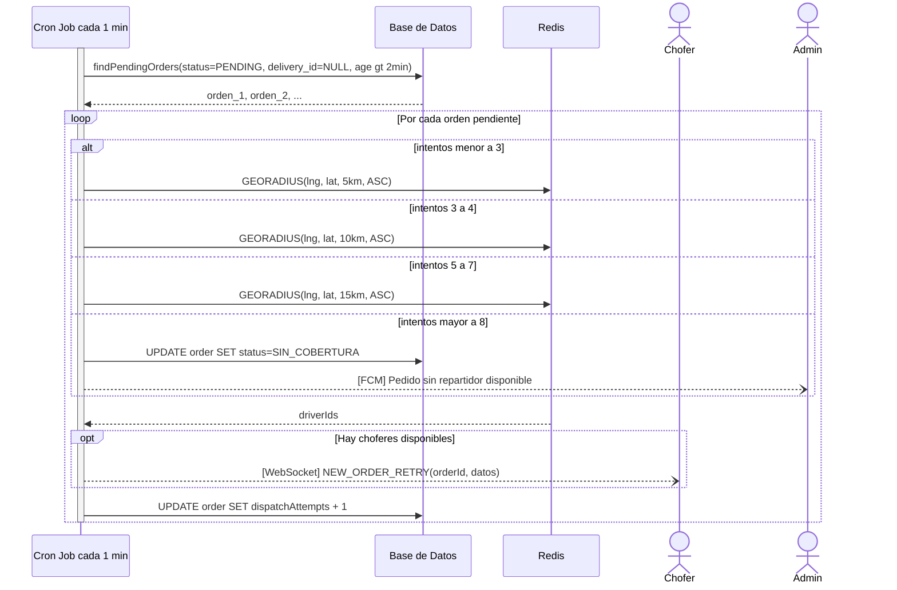

---

### D-07 | DSS — CU-015: Aceptar Pedido

**Plantilla cátedra (Doc 2 §2.1):** DSS disparado por el Chofer al presionar Aceptar. Muestra validaciones y doble notificación al Cliente (WebSocket + FCM).  
**Guardar como:** `docs/dss-cu015-aceptar.png`  
**Insertar en:** Doc 2 §2.1 reemplazando `[ INSERTAR IMAGEN: dss-cu015-aceptar-pedido.png ]`

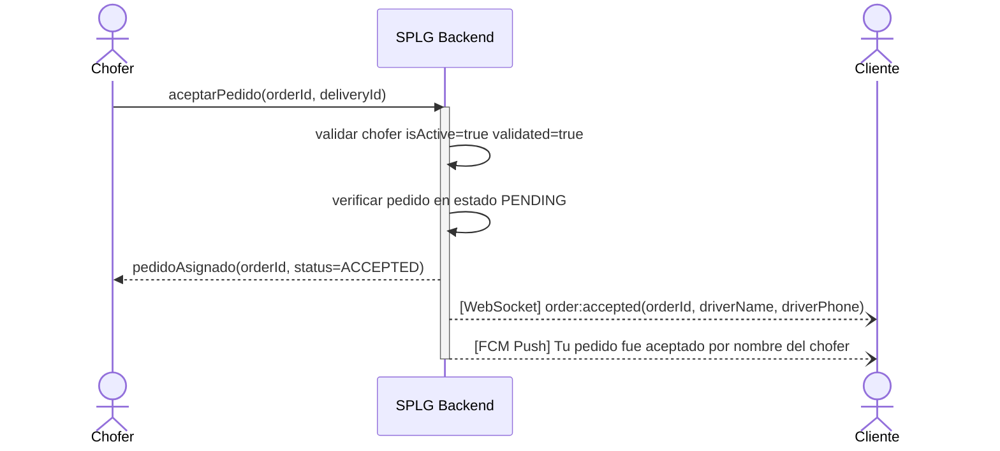

---

### D-08 | DSS — CU-017: Actualizar Ubicación GPS del Chofer

**Plantilla cátedra (Doc 2 §2.1):** DSS de evento fire-and-forget. El Chofer emite su posición periódicamente. El sistema actualiza Redis y, si el pedido está en tránsito, reenvía la posición al Cliente.  
**Guardar como:** `docs/dss-cu017-gps.png`  
**Insertar en:** Doc 2 §2.1 reemplazando `[ INSERTAR IMAGEN: dss-cu017-actualizar-gps.png ]`

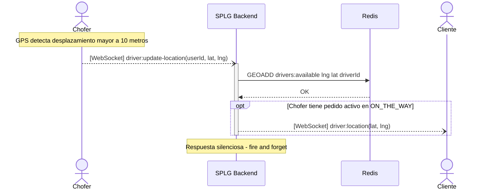

---

### D-09 | DSS — CU-020: Confirmar Entrega

**Plantilla cátedra (Doc 2 §2.1):** DSS del cierre del ciclo del pedido. Muestra la actualización de estado, el pago automático si es efectivo y las notificaciones al Cliente.  
**Guardar como:** `docs/dss-cu020-entrega.png`  
**Insertar en:** Doc 2 §2.1 reemplazando `[ INSERTAR IMAGEN: dss-cu020-confirmar-entrega.png ]`

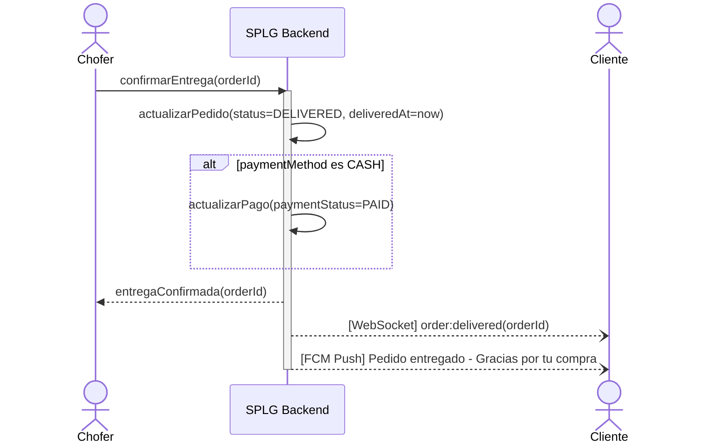

---

### D-10 | DSS — Reserva y Restitución de Stock

**Plantilla cátedra (Doc 2 §2.1):** DSS del proceso transaccional PostgreSQL. Muestra el BEGIN/COMMIT/ROLLBACK al crear pedido y la restitución al cancelar. Actor: Sistema automático.  
**Guardar como:** `docs/dss-stock.png`  
**Insertar en:** Doc 2 §2.1 reemplazando `[ INSERTAR IMAGEN: dss-stock-transaccional.png ]`

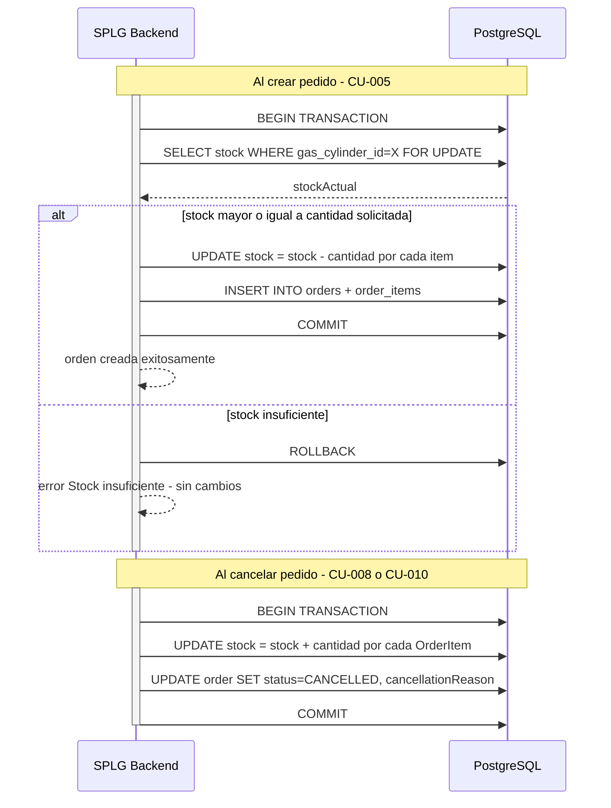

---

## DOC 3 — Arquitectura, Clases de Diseño y Secuencias

---

### D-11 | Arquitectura del Sistema — Vista de Capas

**Plantilla cátedra (Doc 3 §2.1):** Diagrama de arquitectura en capas: frontends, API Gateway con guardias, módulos de negocio, infraestructura y persistencia. Con tecnologías y protocolos de comunicación.  
**Guardar como:** `docs/arquitectura.png`  
**Insertar en:** Doc 3 §2.1 reemplazando el diagrama ASCII

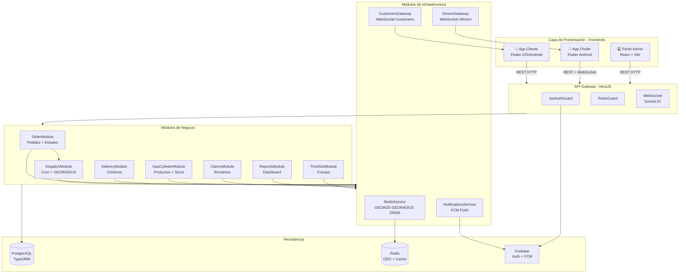

---

### D-12 | Diagrama de Clases de Diseño

**Plantilla cátedra (Doc 3 §5):** Diagrama UML de clases de diseño con atributos, métodos y relaciones. Incluye entidades del dominio, servicios clave y ViewModels Flutter.  
**Guardar como:** `docs/clases-diseno.png`  
**Insertar en:** Doc 3 §5 reemplazando las especificaciones textuales

```mermaid
classDiagram
    class Order {
        <<Entity>>
        +id: string
        +status: OrderStatus
        +paymentMethod: PaymentMethod
        +total: Decimal
        +dispatchAttempts: number
        +createdAt: Date
        +acceptedAt: Date
        +deliveredAt: Date
    }
    class OrderItem {
        <<Entity>>
        +id: string
        +quantity: number
        +unitPrice: Decimal
        +subtotal: Decimal
        +appliedDiscountPct: number
    }
    class GasCylinder {
        <<Entity>>
        +id: string
        +type: string
        +price: Decimal
        +stock: number
        +isActive: boolean
        +promotions: Promotion[]
    }
    class Delivery {
        <<Entity>>
        +id: string
        +isActive: boolean
        +validated: boolean
        +calification: number
        +balance: Decimal
    }
    class Claim {
        <<Entity>>
        +id: string
        +description: string
        +status: ClaimStatus
        +photoUrl: string
        +resolutionNote: string
    }
    class OrderService {
        <<Service>>
        +createOrder(dto, userId) Order
        +updateStatus(id, status, driverId) Order
        +cancelOrder(id, role, userId) Order
        +getOrderStats() StatsDto
    }
    class DispatchService {
        <<Service>>
        +dispatchOrder(order) void
        +handlePendingOrders() void
    }
    class RedisService {
        <<Infrastructure>>
        +geoAdd(key, lng, lat, member) void
        +geoRadius(key, lng, lat, radius) string[]
        +zRem(key, member) void
    }
    class DriversGateway {
        <<WebSocket>>
        +handleConnection(socket) void
        +handleUpdateLocation(socket, data) void
        +notifyNewOrder(driverId, order) void
    }
    class CheckoutViewModel {
        <<ViewModel Flutter>>
        +confirmOrder() void
        +setPaymentMethod(method) void
        +itemsTotal: double
        +transferSurcharge: double
        +finalTotal: double
        +canConfirmOrder: bool
    }
    class HomeViewModel {
        <<ViewModel Flutter>>
        +onData(position) void
        +connect() void
    }

    Order "1" *-- "1..*" OrderItem : items
    OrderItem "0..*" --> "1" GasCylinder : gasCylinder
    Order "0..*" --> "0..1" Delivery : driver
    Order "1" --> "0..1" Claim : claim
    OrderService --> Order : gestiona
    OrderService --> DispatchService : dispara
    DispatchService --> RedisService : consulta
    DispatchService --> DriversGateway : notifica
    CheckoutViewModel --> OrderService : llama
    HomeViewModel --> DriversGateway : emite ubicacion
```

---

### D-13 | Secuencia Diseño — CU-005: Crear Pedido con Despacho

**Plantilla cátedra (Doc 3 §4.1):** Diagrama de secuencia a nivel de diseño con clases reales. Cadena completa: CheckoutViewModel → HistoryService → OrderController → OrderService → QueryRunner → DispatchService → DriversGateway → FCM.  
**Guardar como:** `docs/seq-cu005-diseno.png`  
**Insertar en:** Doc 3 §4.1 reemplazando la representación textual

```mermaid
sequenceDiagram
    actor Cliente
    participant CVM as CheckoutViewModel
    participant HS as HistoryService
    participant OC as OrderController
    participant OS as OrderService
    participant QR as QueryRunner
    participant DS as DispatchService
    participant GW as DriversGateway
    participant FCM as NotificationsService

    Cliente->>CVM: confirmOrder()
    activate CVM
    CVM->>HS: createOrder(orderDto)
    HS->>OC: POST /orders items address paymentMethod timeSlot
    OC->>OS: createOrder(dto, userId)
    activate OS
    OS->>QR: startTransaction()
    QR->>QR: checkStock() SELECT FOR UPDATE
    QR->>QR: calcPricing() decimal.js
    QR->>QR: deductStock() UPDATE gas_cylinder
    QR->>QR: saveOrder() INSERT order + items
    QR->>OS: commitTransaction()
    OS->>DS: triggerDispatch(order)
    activate DS
    DS->>DS: GEORADIUS drivers:available 5km
    DS->>GW: notifyNewOrder(driverId, payload)
    GW-->>DS: emitido via WebSocket
    deactivate DS
    OS->>FCM: sendOrderConfirmation(order)
    OS-->>OC: return order
    deactivate OS
    OC-->>HS: 201 orderId status PENDING
    HS-->>CVM: success
    CVM->>Cliente: navigateTo OrderTrackingView
    deactivate CVM
```

---

### D-14 | Secuencia Diseño — CU-013: Despacho por Proximidad

**Plantilla cátedra (Doc 3 §4.2):** Secuencia de diseño del algoritmo geoespacial: DispatchService → RedisService (GEORADIUS) → validación en DB → DriversGateway (Socket.IO emit).  
**Guardar como:** `docs/seq-cu013-diseno.png`  
**Insertar en:** Doc 3 §4.2 reemplazando la representación textual

```mermaid
sequenceDiagram
    participant OS as OrderService
    participant DS as DispatchService
    participant RS as RedisService
    participant DR as DeliveryRepository
    participant GW as DriversGateway

    OS->>DS: dispatchOrder(order)
    activate DS
    DS->>RS: geoRadius(drivers:available, lng, lat, 5km)
    RS-->>DS: driverId1, driverId2, ...

    loop Para cada driverId en orden de cercania
        DS->>DR: findOne(driverId where isActive=true validated=true)
        DR-->>DS: driver o null
        alt driver valido
            DS->>GW: notifyNewOrder(driverId, orderPayload)
            GW-->>DS: emitido a socket del chofer
        end
    end

    alt Sin choferes elegibles
        Note over DS: Orden queda PENDING para Cron M2
    end
    deactivate DS
```

---

### D-15 | Secuencia Diseño — CU-017: Actualización de Ubicación GPS

**Plantilla cátedra (Doc 3 §4.3):** Secuencia de diseño: LocationService Flutter → HomeViewModel → DriversGateway NestJS → RedisService → CustomersGateway (si pedido activo).  
**Guardar como:** `docs/seq-cu017-diseno.png`  
**Insertar en:** Doc 3 §4.3 reemplazando la representación textual

```mermaid
sequenceDiagram
    participant LS as LocationService
    participant HVM as HomeViewModel
    participant DGW as DriversGateway
    participant RS as RedisService
    participant CGW as CustomersGateway

    LS->>HVM: positionStream.add(position)
    activate HVM
    HVM->>HVM: _updateUserLocation(position)
    HVM--)DGW: [WS emit] driver:update-location userId lat lng
    deactivate HVM
    activate DGW
    DGW->>RS: geoAdd(drivers:available, lng, lat, driverId)
    RS-->>DGW: OK

    opt Chofer tiene pedido activo en estado ON_THE_WAY
        DGW->>CGW: emit driver:location lat lng hacia customerId
        CGW-->>DGW: emitido al cliente
    end
    deactivate DGW
```

---

## DOC 3 — Wireframes de UI

> **Cómo usar esta sección:**
> - Cada wireframe incluye el layout ASCII de referencia y la lista de componentes de Lucidchart o Excalidraw a usar.
> - **Opción rápida:** Ir a [excalidraw.com](https://excalidraw.com) → dibujar con rectangles y texto → exportar PNG.
> - **Opción Lucidchart:** Ir a lucid.app → New Document → Mockup → activar biblioteca "iOS" o "Android" → crear una página por pantalla (frame 390×844px) → exportar PNG.
> - Guardar todos los archivos en `docs/design/`.

---

### D-16 | Wireframe — Catálogo de Productos (App Cliente)

**Plantilla cátedra (Doc 3 §7 / CU-041):** UI App Cliente. Lista de garrafas disponibles con precio, stock y selector de cantidad.  
**Guardar como:** `docs/design/ui-cliente-catalogo.png`  
**Insertar en:** Doc 3 §3.1 (CU-005 pantallas) como primera pantalla del flujo

**Componentes Lucidchart/Excalidraw:**
- `SearchBar`: rectángulo con placeholder texto + icono lupa
- `BannerDireccion`: rectángulo con icono pin + texto dirección + botón Cambiar
- `ProductCard`: rectángulo redondeado con imagen + nombre + stock + precio + botones +/-
- `FABCarrito`: rectángulo redondeado verde en la parte inferior (igual Rappi)

```
┌──────────────────────┐
│ 🔍  Buscar garrafas  │   ← SearchBar
├──────────────────────┤
│ 📍 Av. San Martín... │   ← Banner dirección
│         [Cambiar]    │
├──────────────────────┤
│  Garrafas disponibles│   ← Título sección
├──────────────────────┤
│ ┌─────┐  Garrafa 10kg│
│ │ img │  Stock: 25   │   ← ProductCard
│ │     │  $4.500      │
│ └─────┘  [−] 2 [+]   │
├──────────────────────┤
│ ┌─────┐  Garrafa 15kg│
│ │ img │  Stock: 12   │
│ │     │  $6.200      │
│ └─────┘  [−] 0 [+]   │
├──────────────────────┤
│ ┌─────┐  Garrafa 45kg│
│ │ img │  Stock: 5    │
│ │     │  $15.000     │
│ └─────┘  [−] 0 [+]   │
├──────────────────────┤
│  [🛒 Ver pedido $9.000] │  ← FAB verde (flotante)
└──────────────────────┘
```

---

### D-17 | Wireframe — Checkout (App Cliente)

**Plantilla cátedra (Doc 3 §7 / CU-005):** UI App Cliente. Formulario de confirmación del pedido con resumen, dirección, franja horaria, fecha y método de pago.  
**Guardar como:** `docs/design/ui-cliente-checkout.png`  
**Insertar en:** Doc 3 §3.1 (CU-005) flujo de pantallas

```
┌──────────────────────┐
│ ←  Confirmar pedido  │   ← NavigationBar
├──────────────────────┤
│  RESUMEN DEL PEDIDO  │
│  Garrafa 10kg × 2    │
│  Descuento 5%  −$450 │
│  Subtotal:   $8.550  │
├──────────────────────┤
│  DIRECCIÓN           │
│  [📍 Seleccionar en mapa]│
│  [📋 Mis direcciones]│
├──────────────────────┤
│  FRANJA HORARIA      │
│  ○ Mañana  09:00-13:00│   ← RadioButton
│  ● Tarde   17:00-21:00│   ← Seleccionado
├──────────────────────┤
│  FECHA DE ENTREGA    │
│  [📅 Hoy 03/05/2026] │
├──────────────────────┤
│  MÉTODO DE PAGO      │
│  ● Efectivo          │
│  ○ MercadoPago       │
│  ○ Transferencia+10% │   ← Badge de recargo
├──────────────────────┤
│  TOTAL: $8.550       │
│  [CONFIRMAR PEDIDO]  │   ← Botón primario
└──────────────────────┘
```

---

### D-18 | Wireframe — Seguimiento en Tiempo Real (App Cliente)

**Plantilla cátedra (Doc 3 §7 / CU-017 + CU-021):** UI más importante de la app. Mapa con pin del chofer en movimiento + stepper de estados (igual PedidosYa) + card del chofer.  
**Guardar como:** `docs/design/ui-cliente-tracking.png`  
**Insertar en:** Doc 3 §3.5 (CU-017) pantallas

**Componentes clave:**
- Mapa: rectángulo gris claro con marcadores (📍 casa del cliente, 🚗 chofer)
- Stepper: 4 círculos conectados con línea, el actual coloreado (igual PedidosYa)
- Card chofer: rectángulo blanco con nombre, vehículo y ETA

```
┌──────────────────────┐
│ ←  Tu pedido #1234   │   ← NavigationBar
├──────────────────────┤
│                      │
│   [  MAPA GOOGLE  ]  │   ← Frame mapa (fondo gris/verde)
│                      │
│      📍 Tu casa      │
│        ↑             │
│      🚗 Juan G.      │   ← Marcador con avatar del chofer
│                      │
├──────────────────────┤
│ ✅ ── ✅ ── 🔵 ── ⬜ │   ← Stepper de estados
│ Pend. Acept Camino Entregado│
│             ↑ actual │
├──────────────────────┤
│ 🧑 Juan García       │   ← Card del chofer
│ 🚗 Renault Kangoo    │
│ ⏱ ETA: ~15 minutos  │
├──────────────────────┤
│ [📞 Llamar] [Cancelar]│   ← Botones de acción
└──────────────────────┘
```

---

### D-19 | Wireframe — Login y Registro (App Cliente + Chofer)

**Plantilla cátedra (Doc 3 §7 / CU-001 + CU-002):** UI de autenticación compartida por App Cliente y App Chofer.  
**Guardar como:** `docs/design/ui-login.png`  
**Insertar en:** Doc 3 (sección Login)

```
--- Pantalla Login ---          --- Pantalla Registro ---
┌──────────────────────┐        ┌──────────────────────┐
│                      │        │ ←  Crear cuenta      │
│    🔥  SPLG Gas      │        ├──────────────────────┤
│                      │        │  Nombre completo     │
├──────────────────────┤        │  [Nombre Apellido]   │
│  Email               │        ├──────────────────────┤
│  [usuario@mail.com]  │        │  Email               │
├──────────────────────┤        │  [usuario@mail.com]  │
│  Contraseña          │        ├──────────────────────┤
│  [••••••••] 👁       │        │  Teléfono            │
├──────────────────────┤        │  [+54 9 XXX XXXX]    │
│    [  INGRESAR  ]    │        ├──────────────────────┤
├──────────────────────┤        │  Contraseña          │
│  ¿No tenés cuenta?   │        │  [Min. 6 caracteres] │
│    [REGISTRARSE]     │        ├──────────────────────┤
└──────────────────────┘        │   [CREAR CUENTA]     │
                                └──────────────────────┘
```

---

### D-20 | Wireframe — Home del Chofer (App Chofer)

**Plantilla cátedra (Doc 3 §7 / CU-022):** UI principal del chofer. Mapa con su posición actual + toggle grande de disponibilidad (igual Rappi Repartidor).  
**Guardar como:** `docs/design/ui-chofer-home.png`  
**Insertar en:** Doc 3 §3.2 (CU-013) pantallas del chofer

```
┌──────────────────────┐
│ 👋 Hola, Juan        │   ← Header con nombre
│ Pedidos hoy: 3       │
├──────────────────────┤
│                      │
│  [   MAPA GOOGLE  ]  │   ← Mapa con pin del chofer
│                      │
│        📍 Yo         │
│                      │
├──────────────────────┤
│  DISPONIBILIDAD      │
│ ┌────────────────┐   │
│ │  🟢  ACTIVO    │   │   ← Toggle Switch grande
│ │  [══════════●] │   │     (verde = activo)
│ └────────────────┘   │
├──────────────────────┤
│  Ganancias hoy: $X   │   ← Mini stat
└──────────────────────┘
```

---

### D-21 | Wireframe — Pedido Entrante Bottom Sheet (App Chofer)

**Plantilla cátedra (Doc 3 §7 / CU-015):** UI de pedido entrante. Bottom sheet que sube desde abajo con datos del pedido, distancia y botones Aceptar/Rechazar (igual Rappi).  
**Guardar como:** `docs/design/ui-chofer-pedido-entrante.png`  
**Insertar en:** Doc 3 §3.4 (CU-015) pantallas

```
┌──────────────────────┐
│                      │
│  [  MAPA - fondo  ]  │   ← Mapa completo de fondo
│                      │
│  ┌────────────────┐  │
│  │ 🔔 NUEVO PEDIDO│  │   ← Bottom Sheet (sube desde abajo)
│  │────────────────│  │
│  │ 📍 Av. San     │  │
│  │    Martín 1234 │  │
│  │────────────────│  │
│  │ • Garrafa 10kg │  │
│  │   × 2 unidades │  │
│  │────────────────│  │
│  │ 💰 Total: $9.000│ │
│  │ 📏 Dist: 2.3km │  │
│  │────────────────│  │
│  │   ⏱ 28 seg ... │  │   ← Countdown timer
│  │────────────────│  │
│  │ [✅ ACEPTAR]   │  │   ← Botón verde
│  │ [❌ RECHAZAR]  │  │   ← Botón rojo
│  └────────────────┘  │
└──────────────────────┘
```

---

### D-22 | Wireframe — En Ruta (App Chofer)

**Plantilla cátedra (Doc 3 §7 / CU-018 + CU-020):** UI del chofer navegando hacia el cliente. Mapa con ruta trazada + botones Avisar Llegada y Confirmar Entrega.  
**Guardar como:** `docs/design/ui-chofer-en-ruta.png`  
**Insertar en:** Doc 3 §3.6 (CU-020) pantallas

```
┌──────────────────────┐
│ ←  Entrega en curso  │   ← NavigationBar
├──────────────────────┤
│                      │
│  [  MAPA + RUTA  ]   │   ← Mapa con ruta trazada A→B
│   ┄┄┄┄┄┄┄┄┄┄┄┄┄┄    │
│   🏠 Destino         │
│         ↑            │
│        🚗            │
│                      │
├──────────────────────┤
│ 👤 Cliente: María G. │   ← Info card
│ 📍 Av. Corrientes 456│
│ 📏 1.8 km restantes  │
├──────────────────────┤
│ [📣 AVISAR LLEGADA]  │   ← Botón outline
│ [✅ CONFIRMAR ENTREGA]│   ← Botón primario verde
└──────────────────────┘
```

---

### D-23 | Wireframe — Dashboard Administrador (Panel Web)

**Plantilla cátedra (Doc 3 §7 / CU-026):** UI Panel Web. Dashboard con KPIs del día, choferes activos y gráfico de ventas últimos 7 días.  
**Guardar como:** `docs/design/ui-admin-dashboard.png`  
**Insertar en:** Doc 3 §7 (pantallas admin)

> Frame para Panel Web: **1280 × 800 px** en Lucidchart (desktop, no mobile)

```
┌──────────────────────────────────────────────┐
│ 🔥 SPLG Admin  [Pedidos][Choferes][Productos]│   ← Navbar
├────────┬─────────────────────────────────────┤
│        │  📊 Dashboard — 03/05/2026           │
│ MENÚ   │  ┌────────┐ ┌────────┐ ┌────────┐  │
│        │  │  12    │ │   7    │ │   3    │  │
│ Pedidos│  │Pedidos │ │Entreg. │ │Activos │  │
│ Choferes  │ hoy   │ │  hoy   │ │choferes│  │
│ Productos │└────────┘ └────────┘ └────────┘  │
│ Stock  │  ┌────────┐ ┌────────┐             │
│ Reclamos  │$84.500 │ │   1    │             │
│        │  │Ventas  │ │Reclamo │             │
│        │  │  hoy   │ │Pend.   │             │
│        │  └────────┘ └────────┘             │
│        │                                     │
│        │  Ventas últimos 7 días              │
│        │  ▓  ▓  ▓  ▓  ▓  ▓  ▓               │
│        │  L  M  X  J  V  S  D               │
└────────┴─────────────────────────────────────┘
```

---

### D-24 | Wireframe — Listado de Pedidos Admin (Panel Web)

**Plantilla cátedra (Doc 3 §7 / CU-011):** UI Panel Web. Tabla paginada con todos los pedidos, filtros y badges de estado de colores.  
**Guardar como:** `docs/design/ui-admin-pedidos.png`  
**Insertar en:** Doc 3 §7 (pantallas admin)

```
┌──────────────────────────────────────────────┐
│ Pedidos  [Estado ▼] [Fecha ▼] [🔍 Buscar]   │   ← Toolbar con filtros
├──────────────────────────────────────────────┤
│ ID    │ Cliente   │ Total   │ Estado    │ Ver│
├───────┼───────────┼─────────┼───────────┼────┤
│ #1234 │ María G.  │ $9.000  │ 🔵 Camino │ 👁 │
│ #1233 │ Carlos P. │ $4.500  │ ✅ Entregado│ 👁 │
│ #1232 │ Ana R.    │ $13.000 │ 🟡 Aceptado│ 👁 │
│ #1231 │ Luis M.   │ $6.200  │ ⏳ Pendiente│👁 │
│ #1230 │ Julia S.  │ $4.500  │ ❌ Cancelado│👁 │
├──────────────────────────────────────────────┤
│   [← Anterior]   Página 1 de 12   [Siguiente →] │
└──────────────────────────────────────────────┘
```

---

## Resumen de Archivos a Generar e Insertar

Una vez renderizados y exportados, insertar cada imagen en los documentos con el siguiente markdown:

```markdown
> 
> *Figura X — Descripción — CU-XXX*
```

| Archivo PNG | Insertar en | Reemplaza |
|-------------|-------------|-----------|
| `diagrama-cu-sistema.png` | Doc 0 §6 y Doc 1 §3 | `[ INSERTAR IMAGEN: diagrama-cu-sistema.png ]` |
| `diagrama-subsistemas.png` | Doc 1 §4 | `[ INSERTAR IMAGEN: diagrama-subsistemas.png ]` |
| `diagrama-conceptual.png` | Doc 2 §1.5 | `[ INSERTAR IMAGEN: diagrama-conceptual.png ]` |
| `dss-cu005-crear-pedido.png` | Doc 2 §2.1 | `[ INSERTAR IMAGEN: dss-cu005-crear-pedido.png ]` |
| `dss-cu013-despacho.png` | Doc 2 §2.1 | `[ INSERTAR IMAGEN: dss-cu013-despacho-automatico.png ]` |
| `dss-cu014-cron.png` | Doc 2 §2.1 | `[ INSERTAR IMAGEN: dss-cu014-cron-reintento.png ]` |
| `dss-cu015-aceptar.png` | Doc 2 §2.1 | `[ INSERTAR IMAGEN: dss-cu015-aceptar-pedido.png ]` |
| `dss-cu017-gps.png` | Doc 2 §2.1 | `[ INSERTAR IMAGEN: dss-cu017-actualizar-gps.png ]` |
| `dss-cu020-entrega.png` | Doc 2 §2.1 | `[ INSERTAR IMAGEN: dss-cu020-confirmar-entrega.png ]` |
| `dss-stock.png` | Doc 2 §2.1 | `[ INSERTAR IMAGEN: dss-stock-transaccional.png ]` |
| `arquitectura.png` | Doc 3 §2.1 | Diagrama ASCII de arquitectura |
| `clases-diseno.png` | Doc 3 §5 | Especificaciones textuales de clases |
| `seq-cu005-diseno.png` | Doc 3 §4.1 | Representación textual de secuencia |
| `seq-cu013-diseno.png` | Doc 3 §4.2 | Representación textual de secuencia |
| `seq-cu017-diseno.png` | Doc 3 §4.3 | Representación textual de secuencia |
| `design/ui-cliente-catalogo.png` | Doc 3 §3.1 | Pantalla 1 flujo CU-005 |
| `design/ui-cliente-checkout.png` | Doc 3 §3.1 | Pantalla 2 flujo CU-005 |
| `design/ui-cliente-tracking.png` | Doc 3 §3.5 | Pantalla CU-017 |
| `design/ui-login.png` | Doc 3 (Login) | Pantalla CU-001/002 |
| `design/ui-chofer-home.png` | Doc 3 §3.2 | Pantalla Home Chofer |
| `design/ui-chofer-pedido-entrante.png` | Doc 3 §3.4 | Pantalla CU-015 |
| `design/ui-chofer-en-ruta.png` | Doc 3 §3.6 | Pantalla CU-018/020 |
| `design/ui-admin-dashboard.png` | Doc 3 §7 | Dashboard admin |
| `design/ui-admin-pedidos.png` | Doc 3 §7 | Listado pedidos admin |
